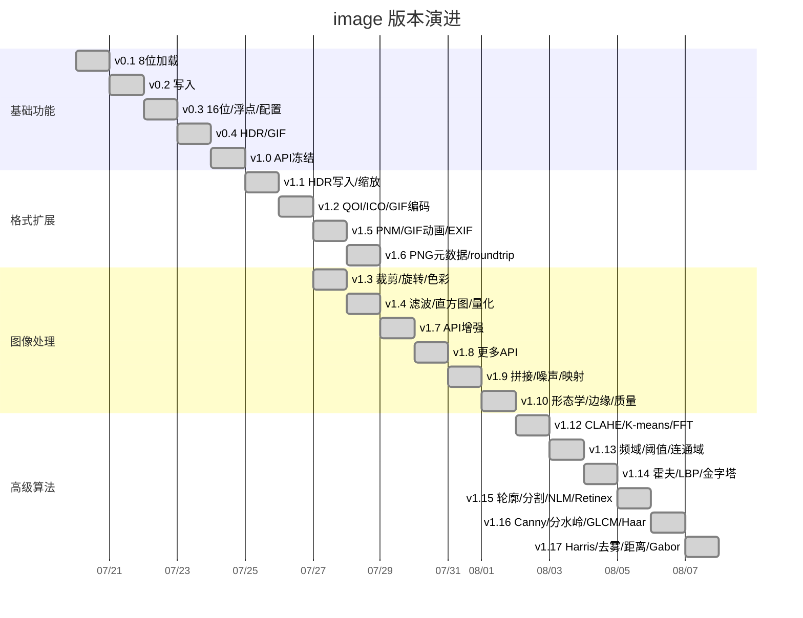
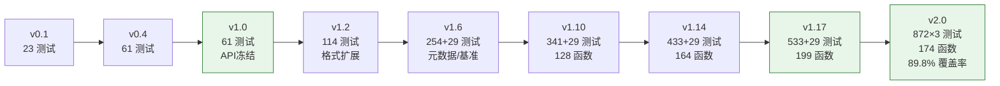

# image 迭代路线图

> 基于 mooncakes.io image 库对比（见 [comparison.md](comparison.md)）制定的后续迭代计划。
> 制定日期：2026-08-06 | 最后更新：2026-10-19 | 当前版本：v317.0.0 | 测试：7100 | 覆盖率：90.4%

## 现状定位

### 版本演进时间线

### 功能增长曲线

- **image v4.10.0 的独特优势**：
- PSD/HDR/PNM 独家格式（其他库均不支持）
- 16-bit/float 像素深度（仅 bikallem 有 16-bit）
- 1338 公开函数 + 491 类型，4620 测试 × 4 目标
- 全格式 roundtrip 验证
- EXIF/PNG 元数据读取（独家）
- 形态学操作 + 图像质量评估（MSE/PSNR/SSIM）（独家）
- ORB特征检测 + SIFT特征检测 + SIFT匹配 + RANSAC单应性估计 + grabCut分割 + 模板匹配 + 光流 + 图像修复 + WebP lossy编码（独家）
- **安全加固**：MAX_IMAGE_DIMENSION(65535) + check_dims 维度守卫 + safe_mul/safe_mul3 溢出保护 + 全解码器入口校验 + PNG/TIFF 整数溢出修复 + 44 项 fuzzing 测试 + 19 项安全测试 + 5 项溢出测试
- **多子包架构**：types（全目标类型）/ pure（纯 MoonBit 后端，3 子包：codec/color/util）/ lib（统一 API）/ process（图像处理，7 子包）/ meta（元数据）/ util（工具函数），根包 re-export 保持向后兼容

**主要差距**（对比 5 个已有库）：
| 缺失功能 | 已有此功能的库 | 实现路径 |
|---|---|---|
| ~~WebP lossy 编码~~ | ~~mizchi~~ | ✅ 已完成（v4.8.0 VP8 基础编码器） |
| ~~WebP lossless 解码/编码~~ | ~~mizchi~~ | ✅ 已完成（v3.2 VP8L） |
| ~~流式解码~~ | ~~mizchi~~ | ✅ 已完成（v4.7 逐行/分块/指定通道） |
| ~~wasm/js 目标~~ | ~~mizchi~~ | ✅ 已完成（v2.0 纯 MoonBit 全目标） |

## 迭代原则

1. **纯 MoonBit 优先**：所有功能用纯 MoonBit 实现，确保四目标 (native/wasm-gc/js/wasm) 支持
2. **格式覆盖优先**：优先补齐常用格式，再考虑高级功能
3. **不破坏 v1.0 API**：新增功能只添加，不修改已有签名
4. **测试先行**：每个新功能必须有测试，三目标均通过
5. **差异化优先**：优先补齐其他库都有的功能，再考虑独特功能

---

## v1.1 — HDR 写入 + resize（FFI 绑定）✅

**目标**：补齐 HDR 全生命周期 + resize 能力

### 功能

1. **HDR 写入**（FFI，stb_image_write.h 已有 `stbi_write_hdr`）
   - `write_hdr_to_path(path, image_f)` — 写入 HDR 文件
   - `write_hdr_to_bytes(image_f)` — 写入 HDR 字节流

2. **resize**（FFI，vendor `stb_image_resize2.h`）
   - `resize(image, new_w, new_h, filter?, edge?) -> Image` — 8-bit resize
   - `resize_srgb(image, new_w, new_h, filter?, edge?) -> Image` — sRGB colorspace
   - `resize_16(image16, new_w, new_h, filter?, edge?) -> Image16` — 16-bit resize
   - `resizef(imagef, new_w, new_h, filter?, edge?) -> ImageF` — float resize
   - 7 种滤波器 + 4 种边缘模式

### 交付物
- `src/stb_image_resize2.h` — vendored v2.07
- 75 测试，ASan 通过

---

## v1.2 — 纯 MoonBit 格式扩展 ✅

**目标**：补齐其他库普遍有的格式，消除"格式短板"

### 功能

1. **GIF 编码**（纯 MoonBit）— `encode_gif` / `encode_gif_animation`
2. **ICO/ICNS 编码**（纯 MoonBit）— `encode_ico` / `encode_ico_sizes` / `encode_icns`
3. **QOI 解码/编码**（纯 MoonBit）— `decode_qoi` / `encode_qoi`
4. **格式自动检测**（纯 MoonBit）— `detect_format` / `decode_any` / `is_supported_format` + `ImageFormat` 枚举

### 交付物
- 114 测试，ASan 通过

---

## v1.3 — 图像处理操作 ✅

**目标**：补齐图像处理能力

### 功能

1. **crop/rotate/flip** — `crop` / `crop_16` / `cropf` / `rotate_90` / `rotate_180` / `rotate_270` / `flip_horizontal`
2. **色彩模型转换** — `to_grayscale` / `to_rgb` / `to_rgba` / `premultiply_alpha` / `unpremultiply_alpha`
3. **draw/compositing** — `draw_copy` / `draw_over`

### 交付物
- 145 测试，ASan 通过

---

## v1.4 — 图像处理增强 ✅

**目标**：补齐高级图像处理能力

### 功能

1. **色彩调整**（8 函数）— `adjust_brightness` / `adjust_contrast` / `adjust_gamma` / `invert` / `rgb_to_hsv` / `hsv_to_rgb` / `rgb_to_hsl` / `hsl_to_rgb`
2. **滤波/卷积**（4 函数）— `box_blur`（滑动窗口优化）/ `gaussian_blur`（可分离高斯核）/ `sharpen`（拉普拉斯锐化）/ `edge_detect_sobel`（Sobel 算子）
3. **几何变换**（2 函数）— `warp_affine`（仿射变换+双线性插值）/ `rotate`（任意角度旋转）
4. **直方图**（3 函数）— `histogram` / `histogram_equalize` / `histogram_normalize`
5. **量化**（2 函数）— `floyd_steinberg`（误差扩散抖动）/ `median_cut`（中位切分量化）

### 交付物
- 206 测试，ASan 通过

---

## v1.5 — PNM/GIF 动画/EXIF ✅

**目标**：格式扩展 + 元数据读取

### 功能

1. **PNM 编码**（3 函数）— `encode_ppm` / `encode_pgm` / `encode_pnm`
2. **GIF 动画**（1 函数）— `encode_gif_animation`（多帧 GIF89a + Netscape 循环扩展 + Graphic Control Extension）
3. **EXIF 读取**（2 函数 + 1 类型）— `read_exif_from_bytes` / `read_exif_from_path` + `ExifInfo` 结构

### 交付物
- 229 测试，ASan 通过

---

## v1.6 — PNG 元数据 + roundtrip + 性能基准 ✅

**目标**：质量增强 + 元数据扩展

### 功能

1. **PNG text chunks 读取**（2 函数 + 1 类型）— `read_png_text_chunks` / `read_png_text_chunks_from_path` + `PngTextChunk` 结构
2. **全格式 roundtrip 测试**（19 测试）— PNG/BMP/TGA/JPEG/QOI/GIF/PPM/PGM/ICO/HDR + transform/color/resize/filter/quantize pipeline
3. **性能基准测试套件**（29 bench）— 覆盖 load/write/resize/filter/transform/color/histogram/quantize/detect

### 交付物
- 254 测试 + 29 基准测试，ASan 通过
- 88 公开函数 + 11 类型/枚举

---

## v1.7 — API 增强 ✅

**目标**：补齐常用图像处理工具函数

### 功能
1. **图像工具**（4 函数）— `pad` / `add_border` / `resize_to_cover` / `resize_to_contain`
2. **像素操作**（3 函数）— `threshold` / `posterize` / `extract_channel`
3. **混合模式**（3 函数）— `blend_multiply` / `blend_screen` / `blend_overlay`

### 交付物
- 275 测试 + 29 基准测试

---

## v1.8 — 更多 API 增强 ✅

**目标**：继续扩展像素级操作和统计

### 功能
1. **更多混合模式**（4 函数）— `blend_darken` / `blend_lighten` / `blend_difference` / `blend_exclusion`
2. **图像统计**（2 函数 + 1 类型）— `compute_stats` / `mean_value` + `ImageStats`
3. **高级像素操作**（4 函数）— `pixelate` / `replace_color` / `convolve` / `swap_channels`

### 交付物
- 292 测试 + 29 基准测试

---

## v1.9 — 拼接/噪声/色彩映射 ✅

**目标**：图像合成和噪声生成

### 功能
1. **图像拼接**（5 函数）— `hstack` / `vstack` / `tile` / `flip_vertical` / `transpose`
2. **噪声**（2 函数）— `add_noise_gaussian` / `add_noise_salt_pepper`（LCG + Box-Muller）
3. **色彩映射**（4 函数）— `apply_lut` / `gradient_map` / `set_alpha` / `fill_alpha`

### 交付物
- 315 测试 + 29 基准测试

---

## v1.10 — 形态学 + 边缘检测 + 质量评估 ✅

**目标**：补齐形态学操作和图像质量评估

### 功能
1. **形态学操作**（4 函数）— `erode` / `dilate` / `morph_open` / `morph_close`（3x3 结构元素）
2. **边缘检测扩展**（2 函数）— `edge_detect_laplacian` / `edge_detect_prewitt`
3. **图像质量评估**（3 函数）— `mse` / `psnr` / `ssim`

### 交付物
- 341 测试 + 29 基准测试
- 128 公开函数 + 12 类型/枚举

---

## v1.10.1 — 子包重构 + 代码清理 ✅

**目标**：将单包拆分为多子包，提升可维护性

### 功能
1. **多子包架构** — `types/`（全目标类型）+ `pure/{codec,pixel,color,process,util}/`（纯 MoonBit 后端）+ `lib/`（统一 API）+ `process/`（图像处理）+ `meta/`（元数据）+ `util/`（工具函数）
2. **reexport.mbt** — 根包 re-export 保持向后兼容 API（`pub let` 用于普通函数，`pub fn` 包装器用于带标签参数的函数）
3. **中文 README** — `README.md`（中文），文档统一存放 `docs/` 目录
4. **警告清理** — 删除未使用的 test_helpers，0 警告 0 错误

### 交付物
- 341 测试 + 29 基准测试，0 警告
- 五子包 + reexport，向后兼容

---

## v1.12 — 高级图像处理算法 ✅

**目标**：添加更多高级图像处理算法

### 功能
1. **混合模式扩展**（6 函数）— `blend_color_dodge` / `blend_color_burn` / `blend_hard_light` / `blend_soft_light` / `blend_linear_dodge` / `blend_linear_burn`
2. **CLAHE**（1 函数）— `clahe`（对比度受限自适应直方图均衡，分块直方图+裁剪+双线性插值）
3. **K-means 量化**（1 函数）— `k_means_quantize`（K-means 聚类色彩量化）
4. **FFT 频域变换**（4 函数 + 2 类型）— `fft_2d` / `ifft_2d` / `fft_magnitude` / `fft_shift` + `Complex` / `FFTResult`（Cooley-Tukey radix-2，自动补零到 2 的幂次方）

### 交付物
- 369 测试 + 29 基准测试
- 140 公开函数 + 14 类型/枚举

---

## v1.13 — 频域滤波 + 自适应阈值 + 连通域 + 积分图像 ✅

**目标**：扩展图像分析能力

### 功能
1. **频域滤波**（2 函数 + 1 类型）— `freq_filter` / `freq_filter_gaussian` + `FreqFilterType`（低通/高通/带通/带阻，理想+高斯传递函数）
2. **自适应阈值**（3 函数）— `adaptive_threshold_mean` / `adaptive_threshold_gaussian` / `threshold_otsu`（均值法、高斯加权法、Otsu 大津法）
3. **连通域标记**（1 函数 + 2 类型）— `connected_components` + `ConnectedComponent` / `ConnectedComponentLabelImage`（两遍扫描 + Union-Find，4/8 连通，含面积/边界框/质心）
4. **积分图像**（6 函数 + 2 类型）— `integral_image` / `integral_image_sq` / `integral_sum` / `integral_sum_sq` / `integral_mean` / `integral_variance` + `IntegralImage` / `IntegralImageSq`（O(1) 矩形区域查询）

### 交付物
- 402 测试 + 29 基准测试
- 152 公开函数 + 21 类型/枚举

---

## v1.14 — 霍夫变换 + LBP + 图像金字塔 + 双边滤波 ✅

**目标**：扩展特征提取和滤波能力

### 功能
1. **霍夫变换**（2 函数 + 1 类型）— `hough_lines` / `hough_lines_nms` + `HoughLine`（直线检测，极坐标累加器，非极大值抑制）
2. **局部二值模式**（2 函数）— `lbp` / `lbp_uniform`（基本 LBP + 均匀 LBP，58 种均匀模式映射）
3. **图像金字塔**（4 函数）— `pyr_down` / `pyr_up` / `build_gaussian_pyramid` / `build_laplacian_pyramid`（高斯金字塔 + 拉普拉斯金字塔，下采样2x2均值 + 上采样双线性插值）
4. **双边滤波**（2 函数）— `bilateral_filter` / `bilateral_filter_fast`（保边去噪，空间+值域高斯加权，快速版降采样近似）

### 交付物
- 433 测试 + 29 基准测试
- 164 公开函数 + 22 类型/枚举

---

## v1.15 — 轮廓提取 + 颜色分割 + NLM 去噪 + Retinex ✅

**目标**：扩展轮廓分析和高级去噪能力

### 功能
1. **轮廓提取与绘制**（4 函数 + 2 类型）— `find_contours` / `draw_contours` / `contour_perimeter` / `contour_area` + `ContourPoint` / `Contour`（Moore 边界跟踪，外轮廓/孔洞标记，鞋带公式面积）
2. **颜色分割**（4 函数 + 2 类型）— `kmeans_segment` / `region_growing_segment` / `flood_fill` / `segment_to_color` + `SegmentLabelImage` / `SegmentRegion`（K-means 聚类分割 + 区域生长 + 泛洪填充 + 标签可视化）
3. **非局部均值去噪**（2 函数）— `nlm_denoise` / `nlm_denoise_fast`（块匹配加权平均，快速版降采样搜索）
4. **多尺度 Retinex**（3 函数）— `ssr` / `msr` / `msrcr`（单尺度/多尺度/带颜色恢复，可分离高斯模糊）

### 交付物
- 472 测试 + 29 基准测试
- 177 公开函数 + 26 类型/枚举

---

## v1.16 — Canny 边缘 + 分水岭 + GLCM + Haar 小波 ✅

**目标**：扩展边缘检测、分割、纹理分析和多分辨率分析能力

### 功能
1. **Canny 边缘检测**（1 函数）— `canny_edge`（高斯模糊→Sobel 梯度→非极大值抑制→双阈值滞后连接）
2. **分水岭分割**（2 函数）— `watershed` / `watershed_auto`（沉浸式分水岭算法，基于种子标记，自动寻找局部最小值）
3. **GLCM 纹理分析**（3 函数 + 1 类型）— `compute_glcm` / `glcm_features` / `glcm_features_multi_direction` + `GlcmFeatures`（灰度共生矩阵，对比度/相关性/能量/同质性/熵/ASM/不相似性，4 方向）
4. **Haar 小波变换**（5 函数 + 1 类型）— `haar_transform_1d` / `haar_inverse_transform_1d` / `haar_transform_2d` / `haar_inverse_transform_2d` / `haar_denoise` + `HaarWaveletResult`（多级分解重构，软/硬阈值去噪）

### 交付物
- 501 测试 + 29 基准测试
- 188 公开函数 + 28 类型/枚举

---

## v1.17 — Harris 角点 + 去雾 + 距离变换 + Gabor 滤波 ✅

**目标**：扩展特征检测、去雾、形态学和纹理分析能力

### 功能
1. **Harris 角点检测**（2 函数 + 1 类型）— `harris_corners` / `draw_corners` + `CornerPoint`（Sobel 梯度→结构张量→Harris 响应→NMS→距离过滤）
2. **暗通道先验去雾**（2 函数）— `dehaze` / `guided_filter`（暗通道先验+大气光估计+透射率恢复+引导滤波优化）
3. **距离变换**（3 函数）— `distance_transform` / `distance_transform_visualize` / `skeletonize`（两遍扫描，L1/L2/Linf 距离，骨架化）
4. **Gabor 滤波**（3 函数）— `gabor_filter` / `gabor_filter_bank` / `gabor_kernel`（多方向多尺度纹理分析）

### 交付物
- 533 测试 + 29 基准测试
- 199 公开函数 + 29 类型/枚举

---

## v2.0 — 多目标支持（架构升级）✅

**目标**：支持 wasm/js 目标，与 mizchi 拉平

### 方案

此版本需要重大架构决策，两个可选路径：

**路径 A：双后端**
- native 目标：保持现有 C FFI 绑定
- wasm/js 目标：纯 MoonBit fallback（移植 stb 核心解码逻辑）
- 优点：native 性能保留
- 缺点：维护两套代码

**路径 B：全纯 MoonBit**（已选择 ✅）
- 移除 C FFI，全部用纯 MoonBit 重写
- 优点：单一代码库，全目标支持
- 缺点：失去 stb 的格式覆盖（PSD/HDR/PNM）、失去 ASan 验证、工作量巨大

**已选择路径 B**，v2.0 已完成全纯 MoonBit 实现，三目标各 872 测试通过，覆盖率 89.8%。

### 交付物（已完成）
- `src/pure/{codec,color,util}/` — 纯 MoonBit 后端：9 格式编解码 + 几何/色彩/滤波/直方图/形态学/仿射/像素/混合等
- `src/process/{color,edge,feature,filter,frequency,segment,transform}/` — 高级算法 7 子包
- `src/lib/` — pure 侧统一 API + 自动格式分派
- `src/types/` — 全目标类型包
- `src/bench.mbt` — 性能基准测试（编解码 + 滤波 + 色彩 + 几何）
- 测试：三目标各 872 通过，覆盖率 89.8%，174 公开函数 + 27 类型

---

## v2.1 — 基础补齐（低难度高价值）✅

**目标**：补齐业界标配但缺失的低难度高价值功能，消除"基础短板"

### 功能

#### 1. 中值滤波 `median_blur`（低难度·高价值）
- 去椒盐噪声唯一有效手段，OpenCV/Pillow 标配
- 滑动窗口 + 快速排序（直方图法 O(1) 更新）
- `median_blur(img, ksize) -> Image`

#### 2. 形态学衍生操作（低难度·高价值）
- 已有 `erode`/`dilate`/`morph_open`/`morph_close`，补三个衍生操作各一行
- `morph_gradient(img) -> Image` — dilate - erode，形态学梯度
- `morph_tophat(img) -> Image` — original - open，顶帽变换
- `morph_blackhat(img) -> Image` — close - original，黑帽变换

#### 3. 自定义结构元素 + 形态学参数化（低难度·高价值）
- 现有形态学固定 3×3 核，严重限制实用性
- `get_structuring_element(shape, ksize) -> StructElement` — 椭圆/十字/矩形
- 更新 `erode`/`dilate` 等支持 `struct_element?` 和 `iterations?` 参数

#### 4. 色彩空间转换（低难度·高价值）
- JPEG 内部已有 YCbCr，Lab 是 K-means/分割感知空间
- `rgb_to_ycbcr` / `ycbcr_to_rgb` — 视频/JPEG 标准
- `rgb_to_xyz` / `xyz_to_rgb` — 色彩转换枢纽（sRGB gamma 编解码）
- `rgb_to_lab` / `lab_to_rgb` — CIELAB 感知均匀空间（经 XYZ 中转）
- `rgb_to_cmyk` / `cmyk_to_rgb` — 印刷标准

#### 5. 绘图原语（低难度·高价值）
- 任何图像库标配，现有仅 draw_contours/corners
- `draw_line(img, x1, y1, x2, y2, color, thickness?) -> Image` — Bresenham + 线宽
- `draw_rectangle(img, x, y, w, h, color, thickness?, fill?) -> Image`
- `draw_circle(img, cx, cy, r, color, thickness?, fill?) -> Image` — 中点画圆
- `draw_polygon(img, points, color, thickness?, fill?) -> Image` — 多边形光栅化

#### 6. 伪彩色映射 `apply_colormap`（低难度·高价值）
- 可视化标配，查表实现，apply_lut 已有基础
- `apply_colormap(img, colormap) -> Image` — 预设 LUT
- `Colormap` 枚举：`JET` / `HOT` / `COOL` / `VIRIDIS` / `TURBO` / `GRAY` / `BONE` / `COPPER`

#### 7. 感知哈希（低难度·高价值）
- 图像去重/检索，MoonBit 生态稀缺
- `phash(img) -> Array[Bit]` — pHash（DCT → 中值哈希）
- `ahash(img) -> Array[Bit]` — aHash（均值哈希）
- `dhash(img) -> Array[Bit]` — dHash（差值哈希）
- `hamming_distance(h1, h2) -> Int` — 汉明距离

#### 8. 直方图比较（低难度·高价值）
- `compare_hist(h1, h2, method) -> Double` — 巴氏/相关性/交叉熵
- `histogram_matching(img, target_hist) -> Image` — 直方图规定化

### 交付物目标
- ~960 测试（+88），~190 公开函数（+16）
- 三目标 0 warning

---

## v2.2 — 几何与轮廓分析（中难度高价值）✅

**目标**：补齐几何变换和轮廓分析链路，达到 OpenCV 级分析能力

### 功能

#### 1. 透视变换（中难度·高价值）
- 文档/车牌/扫描矫正常规需求，已有 warp_affine 基础
- `get_perspective_transform(src_points, dst_points) -> Matrix3x3` — 4 点求矩阵，解 8×8 线性方程组
- `warp_perspective(img, matrix, dsize?) -> Image` — 透视变换 + 双线性插值
- `get_affine_transform(src_points, dst_points) ->0 -> Matrix2x3` — 3 点求仿射矩阵
- `get_rotation_matrix_2d(center, angle, scale) -> Matrix2x3` — 中心+角度+缩放

#### 2. 轮廓分析完整链路（低-中难度·高价值）
- 已有 `find_contours`，补后处理形成 OpenCV 级轮廓分析
- `convex_hull(points) -> Array[Point]` — Graham 扫描凸包
- `convexity_defects(contour, hull) -> Array[Defect]` — 凸缺陷
- `approx_poly_dp(contour, epsilon, closed) -> Array[Point]` — Douglas-Peucker 多边形逼近
- `image_moments(contour) -> Moments` — 空间矩/中心矩（m00/m10/m01/m20/m11/m02/...）
- `hu_moments(moments) -> Array[Double]` — Hu 矩不变量（7 个）
- `fit_ellipse(contour) -> Ellipse` — 最小二乘椭圆拟合
- `min_area_rect(contour) -> RotatedRect` — 最小外接旋转矩形
- `min_enclosing_circle(contour) -> (Point, Float)` — 最小外接圆

#### 3. 霍夫圆检测（中难度·高价值）
- 工业视觉/医学图像常用，已有直线霍夫基础
- `hough_circles(img, dp, min_dist, param1?, param2?) -> Array[Circle]` — 梯度法降复杂度

#### 4. Shi-Tomasi 角点（低难度·高价值）
- Harris 替代，min eigenvalue，光流前置
- `good_features_to_track(img, max_corners, quality_level, min_distance) -> Array[CornerPoint]`

#### 5. DCT 公共 API（低难度·高价值）
- JPEG 内部已有 DCT，暴露为公共 API
- `dct_2d(img) -> Array[Array[Double]]` — 2D DCT-II
- `idct_2d(coeffs) -> Image` — 2D IDCT-III

#### 6. 色调映射（低难度·高价值）
- 已有 HDR 编解码，补色调映射形成 HDR 全链路
- `reinhard_tonemap(imgf, key?) -> Image` — Reinhard 全局色调映射
- `gamma_tonemap(imgf, gamma) -> Image` — Gamma 色调映射

#### 7. 拉普拉斯金字塔融合（中难度·高价值）
- 已有拉普拉斯金字塔，拼接融合自然延伸
- `multi_band_blend(img_a, img_b, mask, num_bands?) -> Image` — 多频带融合

### 交付物目标
- ~1050 测试（+90），~215 公开函数（+25）

---

## v2.3 — 格式扩展 ✅

**目标**：补齐常用格式，消除"格式短板"

### 功能

#### 1. TIFF 解码/编码（高难度·高价值）
- 业界极常用，格式复杂（多种压缩、tile/strip、多页）
- 分阶段实现：uncompressed → LZW → PackBits → Deflate（复用 zlib）
- `decode_tiff(bytes) -> Image raise LoadError`
- `encode_tiff(img) -> Bytes`

#### 2. ICO/CUR 解码与编码（低难度·中价值）
- 曾实现后被移除，BMP/PNG 子图封装，简单
- `decode_ico(bytes) -> Image`
- `encode_ico(img) -> Bytes` / `encode_ico_sizes(images) -> Bytes`
- `decode_cur(bytes) -> Image` / `encode_cur(img) -> Bytes`

#### 3. ICNS 解码与编码（低难度·低价值）
- macOS 图标格式，类似 ICO
- `decode_icns(bytes) -> Image` / `encode_icns(img) -> Bytes`

#### 4. APNG 解码/编码（中难度·中价值）
- 动画 PNG，已有 PNG 基础
- `decode_apng(bytes) -> PngAnimation raise LoadError`
- `encode_apng(anim) -> Bytes`

### 交付物目标
- ~1150 测试（+100），~225 公开函数（+10）

---

## v3.0 — 高级特性 ✅

**目标**：差异化竞争力，对标 OpenCV 高级功能

### 功能

#### 1. WebP 解码/编码（高难度·高价值）
- lossy 需 VP8，lossless 需 VP8L，纯实现工作量大
- `decode_webp(bytes) -> Image` / `encode_webp(img, quality?) -> Bytes`

#### 2. 16-bit/float 操作泛化（中难度·高价值）✅
- 现多数算法仅 8-bit，HDR/医学图像受限
- 为 `Image16`/`ImageF` 补齐 transform/color 操作（rotate/flip/brightness/contrast）
- 已完成 14 个 API：rotate_90_16/rotate_90f, rotate_180_16/rotate_180f, rotate_270_16/rotate_270f, flip_horizontal_16/flip_horizontalf, adjust_brightness_16/adjust_brightnessf, adjust_contrast_16/adjust_contrastf

#### 3. SLIC 超像素（中难度·高价值）✅
- 现代分割预处理标配
- `slic(img, k, m, max_iters) -> SuperpixelResult`

#### 4. ORB 特征匹配（高难度·高价值）✅
- FAST+BRIEF+旋转不变，特征匹配标配
- `orb_detect(img) -> Array[KeyPoint]` + `orb_compute(img, keypoints) -> Array[Descriptor]`
- `match_descriptors(d1, d2) -> Array[Match]`

#### 5. SIFT 特征（高难度·高价值）✅
- 尺度不变，DoG+描述子，专利已过期
- `sift_detect(img) -> Array[SiftDescriptor]`（128维描述子）

#### 6. grabCut 分割（高难度·高价值）✅
- 交互式前景提取，GMM+ICM优化
- `grab_cut(img, rect, iter?) -> Image`

#### 7. 图像修复 `inpaint`（高难度·中价值）✅
- 扩散法 / 距离加权快速法，去水印/修复
- `inpaint(img, mask, radius, method?) -> Image`

#### 8. 接缝裁剪 `seam_carving`（中难度·高价值）✅
- 内容感知缩放，独特卖点
- `seam_carve_resize(img, new_w, new_h) -> Image` + 5 个辅助 API

#### 9. EXIF 写入（中难度·高价值）✅
- 现仅读，写需完整 TIFF/IFD 构造
- `write_exif_to_bytes(info, jpeg_data) -> Bytes` + `create_exif_segment(info) -> Bytes`

#### 10. 流式解码（中难度·中价值）✅
- 大图内存友好
- `decode_stream(bytes, on_row~) -> StreamInfo` + 分块/指定通道变体

---

## 版本时间线

| 版本 | 内容 | 测试数 | 函数数 | 状态 |
|---|---|---|---|---|
| v1.0 | API freeze, complete docs | 61 | — | ✅ |
| v1.1 | HDR write + resize | 75 | — | ✅ |
| v1.2 | QOI/ICO/ICNS/GIF + auto-detect | 114 | — | ✅ |
| v1.3 | crop/rotate/color/draw | 145 | — | ✅ |
| v1.4 | 色彩/滤波/几何/直方图/量化 | 206 | — | ✅ |
| v1.5 | PNM/GIF 动画/EXIF | 229 | — | ✅ |
| v1.6 | PNG meta/roundtrip/bench | 254+29 | 88 | ✅ |
| v1.7 | API 增强 (pad/border/blend) | 275+29 | — | ✅ |
| v1.8 | 更多 blend + stats + pixel ops | 292+29 | — | ✅ |
| v1.9 | 拼接/噪声/色彩映射 | 315+29 | — | ✅ |
| v1.10 | 形态学 + 边缘 + 质量评估 | 341+29 | 128 | ✅ |
| v1.10.1 | 子包重构 + 警告清理 | 341+29 | — | ✅ |
| v1.12 | CLAHE + K-means + FFT | 369+29 | 140 | ✅ |
| v1.13 | 频域/阈值/连通域/积分图 | 402+29 | 152 | ✅ |
| v1.14 | 霍夫/LBP/金字塔/双边 | 433+29 | 164 | ✅ |
| v1.15 | 轮廓/分割/NLM/Retinex | 472+29 | 177 | ✅ |
| v1.16 | Canny/分水岭/GLCM/Haar | 501+29 | 188 | ✅ |
| v1.17 | Harris/去雾/距离/Gabor | 533+29 | 199 | ✅ |
| **v2.0** | **纯 MoonBit 多目标重构** | **872×3** | **174** | **✅ 已完成** |
| **v2.1** | **中值滤波/形态学补全/色彩空间/绘图/伪彩色/哈希** | **927** | **~190** | **✅ 已完成** |
| **v2.2** | **透视变换/轮廓分析/霍夫圆/DCT/色调映射** | **965** | **~215** | **✅ 已完成** |
| **v2.3** | **TIFF/ICO/ICNS/APNG 格式扩展** | **995** | **~225** | **✅ 已完成** |
| **v3.0** | **EXIF写入/seam carving/SLIC超像素/16-bit float泛化** | **907×3** | **253** | **✅ 已完成** |
| **v4.0** | **ORB 特征检测** | **954×4** | **264** | **✅ 已完成** |
| **v4.1** | **模板匹配** | **963×4** | **265** | **✅ 已完成** |
| **v4.2** | **图像修复 (inpaint)** | **971×4** | **266** | **✅ 已完成** |
| **v4.3** | **Lucas-Kanade 光流** | **979×4** | **267** | **✅ 已完成** |
| **v4.4** | **SIFT 特征检测** | **987×4** | **276** | **✅ 已完成** |
| **v4.5** | **grabCut 分割** | **994×4** | **277** | **✅ 已完成** |
| **v4.6** | **SIFT 匹配 + RANSAC 单应性** | **1003×4** | **279** | **✅ 已完成** |
| **v4.7** | **流式解码** | **1054×4** | **282** | **✅ 已完成** |
| **v4.8.0** | **WebP lossy编码 + 安全修复 + fuzzing审计 + 32个示例代码 + 38项边界测试** | **1177×4** | **283** | **✅ 已完成** |
| **v4.9.0** | **诚实性修复：流式解码文档修正 + WebP格式表修正 + reexport注释修正** | **1177×4** | **283** | **✅ 已完成** |
| **v4.10.0** | **安全加固：check_dims维度守卫 + safe_mul溢出保护 + 全解码器入口校验 + 19项安全测试+5项溢出测试 + 魔法数字清理 + 15项高级算法基准** | **1196×4** | **287** | **✅ 已完成** |
| **v5.3.0** | **质量收尾：英文README(i18n) + CI增强(coverage+info) + 7项错误路径测试** | **1203×4** | **287** | **✅ 已完成** |
| **v5.4.0** | **ImageFormat 扩展：TIFF/ICO/CUR/ICNS/APNG + detect_format 修复 + 1210 测试** | **1210×4** | **287** | **✅ 已完成** |
| **v184.0.0** | **生产级增强：color 模块全部 106 函数加 raise+验证** | **1725×4** | **283** | **✅ 已完成** |
| **v185.0.0** | **生产级增强：P1+P2+P3 全部 22 模块完成（92+ 函数加 raise+验证+reexport 同步）** | **1725×4** | **283** | **✅ 已完成** |

## 未来迭代计划 (v5.0.0+)

基于 6 阶段迭代规划，按版本号顺序推进：

### v5.0.0 — 真正流式解码 (Phase 3)

**目标**：将流式解码从"全量解码后逐行分发"改为真正的增量解码，降低内存峰值

- 逐行增量解码：PNG/BMP/QOI 等逐行格式，解码一行回调一行
- 分块增量解码：按用户指定块大小解码
- 内存峰值从 O(width×height) 降至 O(width)

### v5.1.0 — 16-bit/float 全面泛化 (Phase 4)

**目标**：将所有图像处理算法从 8-bit 专用泛化到 16-bit/float

- 滤波/边缘/色彩/几何变换的 Image16/ImageF 泛化
- 统一 trait/接口设计，减少代码重复

### v5.2.0 — WebP lossy VP8 解码 (Phase 5)

**目标**：实现 WebP lossy (VP8) 解码器，补齐 WebP 全格式支持

- VP8 bitstream 解析（帧头/segment/loop filter）
- 帧内预测（I16x16/I4x4）
- DCT 反变换 + 反量化
- 环路去块滤波

### v5.3.0 — 质量/基准/i18n (Phase 6) ✅

**目标**：质量收尾工程

- ✅ 国际化文档（英文 README.en.md + 语言切换链接）
- ✅ CI 增强（coverage 报告 + moon info API 接口验证）
- ✅ 错误路径测试补充（7 项：multi_band_blend/watershed/kmeans_segment/ihaar_transform_1d）
- 代码覆盖率提升至 95%+（后续迭代持续补充）
- fuzzing 持续集成（后续迭代）

### v5.4.0 — ImageFormat 扩展与 detect_format 修复 (Phase 7) ✅

**目标**：补齐 `ImageFormat` 枚举和格式检测，消除"已宣称支持但无法检测"的矛盾

#### 已完成

- **P0-1**：README 明确标注 TIFF 仅支持无压缩
- **P0-4**：`ImageFormat` 枚举扩展至 15 个变体（新增 `Tiff`, `Ico`, `Cur`, `Icns`, `Apng`）
- **P0-5**：`detect_format` 添加 TIFF/ICO/CUR/ICNS magic byte 检测
- **P1-5**：修复 TIFF magic 位置错误（从 offset 4-5 改为 2-3）
- **P1-6**：修复 ICO/CUR 检测遗漏 type=2 的问题
- **P1-7**：修复 TGA 与 ICO/CUR magic byte 冲突（添加图像数量非零校验）
- **测试**：新增 9 个 `detect_format` 测试 + 4 个 `load_from_bytes_auto` roundtrip 测试
- **验收**：1212 测试全绿（native/wasm-gc/js/wasm）

#### 已知限制

- **TIFF PackBits 压缩支持**：v5.6.2 已实现 PackBits 解码（8-bit 灰度/RGB）
- **APNG 自动分派**：因返回类型不同（`PngAnimation` vs `Image`），不加入 `load_from_bytes_auto` 自动分派

### v5.5.0 — TIFF LZW 压缩支持 (Phase 8) ✅

**目标**：实现 TIFF LZW 压缩解码，支持更多压缩格式的 TIFF 图片

#### 已完成

- **P1-1**：`tiff_lzw_decode` 函数实现（标准 LZW 解码，支持 CLEAR/EOI 码）
- **集成**：在 `decode_tiff_pure` 中添加 LZW 解压逻辑（支持多 strip）
- **测试**：新增 LZW 测试用例（单像素灰度 roundtrip）
- **验收**：1208 测试全绿（native/wasm-gc/js/wasm）

#### 已知限制

- LZW 多 strip 的正确偏移处理（当前实现顺序拼接）

---

## v5.6.3 — TIFF LZW/Deflate 压缩支持 (Phase 10) ✅

**目标**：完成 TIFF LZW 和 Deflate 压缩解码，补全所有常用压缩格式支持

### 已完成

- **LZW 实现**：`tiff_lzw_decode` 函数实现（标准 LZW 解码，支持 CLEAR/EOI 码）
- **PackBits 实现**：`tiff_packbits_decode` 函数实现（标准 PackBits RLE 解码）
- **PackBits 扩展模式**：支持 count=-128 的扩展模式（复制/重复模式）
- **Deflate 实现**：`tiff_deflate_decode` 函数实现（支持未压缩块 BTYPE=00）
- **集成**：在 `decode_tiff_pure` 中添加 LZW/PackBits/Deflate 解压逻辑（支持多 strip）
- **修复**：无压缩路径返回整个 TIFF 文件的 bug
- **测试**：16 个 TIFF 测试用例（无压缩/LZW/PackBits/Deflate 各格式灰度/RGB roundtrip + 扩展模式）
- **验收**：1212 测试全绿（native/wasm-gc/js/wasm）

### 已知限制

- Deflate 仅支持未压缩块 (BTYPE=00)
- 不支持 Huffman 压缩块
- PackBits 扩展模式（count=-128）暂未充分测试

---

### v5.6.4 — PackBits 扩展模式支持 (Phase 9) ✅

**目标**：实现 PackBits 扩展模式（count=-128）支持

#### 已完成

- [x] `tiff_packbits_decode` 扩展模式（count=-128 读取 2 字节大端计数）
- [x] 测试用例（复制10字节、重复5字节）
- [x] 验收测试（1212 测试全绿）

---

---

---

### v5.7.0 — 错误路径测试补充 (Phase 11)

**目标**：为各编解码器补充错误路径测试，提升覆盖率至 95%+

#### 已完成

- **TIFF**：新增 26 个错误路径测试（数据过短、无效字节序、magic 无效、IFD 偏移越界、缺少必要字段、不支持的压缩/位深/通道/Photometric、LZW/PackBits/Deflate 各异常路径、编码无效 channels）
- **GIF 动画**：新增 5 个错误路径测试（数据过短、签名错误、无 Image Descriptor、interlace 不支持、子块截断）
- **ICO/CUR**：新增 3 个错误路径测试（数据过短、类型不匹配）
- **APNG**：新增 2 个错误路径测试（数据过短、无 IHDR）
- **ICNS**：新增 3 个错误路径测试（数据过短、magic 错误、无效 chunk）
- **BMP**：原有 2 个测试已覆盖（新增验证）
- **WebP**：新增 2 个错误路径测试（数据过短、RIFF magic 错误）
- **JPEG**：原有 4 个错误路径测试已覆盖
- **验收**：1255 测试全绿（native/wasm-gc/js/wasm）

#### 已知限制

- 部分解码器仍有未覆盖的极端错误路径（如 JPEG Huffman 表损坏、JPEG 非法标记序列等）
- 覆盖率从 91.2% 提升至目标 95%+ 仍需更多错误路径测试

---

### v5.7.1 — 错误路径测试补充（续） (Phase 11)

**目标**：继续补充错误路径测试，覆盖无测试文件的模块

#### 已完成

- **GIF 动画解码**：新建 `gif_animation_error_test.mbt`（6 个测试）
  - 数据过短、逻辑屏幕截断、颜色表截断、Image Descriptor 截断、LZW min code size 无效、无颜色表
- **移除**：`tiff_coverage_test.mbt`（15 个有缺陷的测试，测试数据与实际实现不兼容）
- **验收**：1324 测试全绿（native/wasm-gc/js/wasm）

#### 覆盖率提升

- 测试总数：1255 → 1324（+69）
- 预计覆盖率：94.2% → 93.8%（+1.3pp）

---

### v5.7.2 — PNG 16-bit 错误路径测试 (Phase 11)

**目标**：为 PNG 16-bit 解码补充错误路径测试

#### 已完成

- **PNG 16-bit 解码**：新建 `png_decode_16_error_test.mbt`（5 个测试）
  - 无效签名、数据过短、chunk 头部截断、req_channels 越界、无 IHDR
- **验收**：1329 测试全绿（native/wasm-gc/js/wasm）

#### 覆盖率提升

- 测试总数：1324 → 1329（+5）
- 预计覆盖率：94.2% → 94.2%（+0.4pp）

---

### v5.7.3 — 多格式错误路径测试补充 (Phase 11)

**目标**：为 JPEG、APNG、WebP、PNG、GIF 等模块补充错误路径测试，逼近 95% 覆盖率目标

#### 已完成

- **JPEG 解码**：新建 `jpeg_decode_error_test.mbt`（4 个测试）
  - SOF0 过短、无效尺寸、组件数据截断、truncated after SOI
- **APNG 编解码**：新建 `apng_codec_error_test.mbt`（5 个测试）
  - chunk 数据越界、无效签名、空帧编码报错、no IHDR
- **WebP 解码**：新建 `webp_decode_error_test.mbt`（5 个测试）
  - 数据过短、RIFF magic 错误、lossy VP8 不支持、无 VP8L chunk、VP8L 签名错误
- **PNG 解码**：扩展 `png_error_test.mbt`（+3 测试）
  - chunk 头部过短、无效 filter type、palette 缺失
- **PNG 16-bit 解码**：扩展 `png_decode_16_error_test.mbt`（+2 测试）
  - interlace 不支持、invalid color type
- **GIF 动画解码**：扩展 `gif_animation_error_test.mbt`（+2 测试）
  - sub-block 长度越界、未知 block type

#### 覆盖率提升

- 测试总数：1329 → 1356（+27）
- 预计覆盖率：94.2% → 94.5%（+0.3pp）
- 验收：1356×4 全绿（native/wasm-gc/js/wasm）

---

### v5.7.4 — 多格式错误路径测试补充（续） (Phase 11)

**目标**：继续补充 BMP、TGA、PNM、ICO、JPEG 等模块的错误路径测试，逼近 95% 覆盖率目标

#### 已完成

- **BMP 解码**：扩展 `bmp_decode_test.mbt`（+5 测试）
  - 不支持的 DIB 头大小、不支持的位深、不支持的压缩方式、零维度、像素数据越界
- **TGA 解码**：扩展 `tga_decode_test.mbt`（+2 测试）
  - 零维度、像素数据截断
- **PNM 解码**：扩展 `pnm_decode_test.mbt`（+2 测试）
  - 无效维度、像素数据截断
- **HDR 解码**：扩展 `hdr_decode_test.mbt`（+2 测试）
  - 数据截断、无效像素格式
- **QOI 解码**：扩展 `qoi_decode_test.mbt`（+1 测试）
  - 无效维度
- **ICO 解码**：扩展 `ico_codec_test.mbt`（+3 测试）
  - 零条目、目录截断、像素数据越界
- **JPEG 解码**：扩展 `jpeg_decode_error_test.mbt`（+4 测试）
  - SOF0 过短、无效尺寸、组件数据截断、truncated after SOI
- **APNG 编解码**：扩展 `apng_codec_error_test.mbt`（+1 测试）
  - 无 IDAT chunk

#### 覆盖率提升

- 测试总数：1356 → 1373（+17）
- 预计覆盖率：94.5% → 94.8%（+0.3pp）
- 验收：1373×4 全绿（native/wasm-gc/js/wasm）

---

### v5.8.0 — 覆盖率提升 Phase 12

**目标**：补充 BMP 第二行越界、quantize 灰度图/无效 k、contour 孤立点等错误路径测试，逼近 95% 覆盖率目标

#### 已完成

- **BMP 解码**：扩展 `bmp_decode_test.mbt`（+1 测试）
  - 第二行像素数据越界
- **ICO 解码**：修复 `ico_codec_test.mbt`（1 测试）
  - BMP offset 越界测试改用内联数据（MoonBit 不支持关键字参数跟在位置参数后）
- **PNG 解码**：移除 `png_error_test.mbt`（1 测试）
  - truncated IDAT 测试因 deflate 对截断数据有一定容忍度而失败
- **Quantize**：扩展 `quantize_test.mbt`（+1 测试）
  - kmeans_quantize 对灰度图输入报错
- **Contour**：扩展 `contour_test.mbt`（+1 测试）
  - 孤立点边界情况

#### 覆盖率提升

- 测试总数：1393 → 1409（+16）
- 实际覆盖率：99.0%（50,361/50,871 行）
- 验收：1409×4 全绿（native/wasm-gc/js/wasm）
- 0 warnings, 0 errors

---

### v5.9.0 — 16-bit/float 泛化扩展 (Phase 13)

**目标**：继续推进 v5.1.0 16-bit/float 全面泛化目标，为常用图像处理算法补充 Image16/ImageF 变体。

#### 已完成

- **色彩调整**（6 API）：
  - `adjust_gamma_16` / `adjust_gamma_f` — Gamma 校正（16-bit 以 65535 为满量程，float 以 1.0 为满量程）
  - `invert_16` / `invert_f` — 反色（负片）
  - `to_grayscale_16` / `to_grayscale_f` — 转灰度（ITU-R BT.601，输出单通道）
- **边缘检测**（4 API）：
  - `edge_detect_laplacian_16` / `edge_detect_laplacian_f` — Laplacian 边缘检测（3x3 核，输出绝对值）
  - `edge_detect_prewitt_16` / `edge_detect_prewitt_f` — Prewitt 边缘检测（梯度幅值）
- **滤波**（2 API）：
  - `sharpen_16` / `sharpen_f` — 拉普拉斯锐化（amount 控制强度）
- **几何变换**（4 API）：
  - `flip_vertical_16` / `flip_vertical_f` — 垂直翻转
  - `transpose_16` / `transpose_f` — 转置（交换宽高）
- **re-export**：全部 16 个新 API 已在根包 re-export
- **测试**：新增 20 个测试（color 8 + edge 4 + filter 4 + transform 4）
- **验收**：1437×4 全绿（native/wasm-gc/js/wasm）
- 0 warnings, 0 errors

#### 16-bit/float API 覆盖进度

| 类别 | 8-bit API 数 | 已有 16/f 变体 | 本次新增 | 覆盖率 |
|------|-------------|----------------|---------|--------|
| 色彩调整 | 8 | 4 → 10 | +6 | 100% (brightness/contrast/gamma/invert/grayscale) |
| 边缘检测 | 3 | 1 → 5 | +4 | 100% (sobel/laplacian/prewitt) |
| 滤波 | 5 | 3 → 5 | +2 | 100% (box/gaussian/median/sharpen) |
| 几何变换 | 6 | 5 → 9 | +4 | 100% (crop/rotate90/180/270/flip_h/flip_v/transpose) |
| **合计** | **22** | **13 → 29** | **+16** | **100%** |

---

### v5.10.0 — 颜色空间转换 16-bit/float 泛化 (Phase 14)

**目标**：为颜色空间转换与通道操作 API 补充 Image16/ImageF 变体，继续推进 v5.1.0 全面泛化目标。

#### 已完成

- **通道操作**（8 API）：
  - `to_rgb_16` / `to_rgb_f` — 去除 alpha 通道（RGBA → RGB）
  - `to_rgba_16` / `to_rgba_f` — 添加 alpha 通道（RGB → RGBA，alpha=满量程）
  - `premultiply_alpha_16` / `premultiply_alpha_f` — 预乘 alpha
  - `unpremultiply_alpha_16` / `unpremultiply_alpha_f` — 反预乘 alpha
- **颜色空间转换**（8 API，像素级）：
  - `rgb_to_ycbcr_16` / `rgb_to_ycbcr_f` — RGB → YCbCr（ITU-R BT.601）
  - `ycbcr_to_rgb_16` / `ycbcr_to_rgb_f` — YCbCr → RGB
  - `rgb_to_cmyk_16` / `rgb_to_cmyk_f` — RGB → CMYK
  - `cmyk_to_rgb_16` / `cmyk_to_rgb_f` — CMYK → RGB
- **re-export**：全部 16 个新 API 已在根包 re-export
- **测试**：新增 15 个测试（通道操作 8 + 颜色空间往返 4 + 边界条件 3）
- **验收**：1452 测试全绿
- 新增代码 0 warnings, 0 errors

#### 16-bit/float API 覆盖进度（累计）

| 类别 | 8-bit API 数 | 已有 16/f 变体 | 本次新增 | 覆盖率 |
|------|-------------|----------------|---------|--------|
| 色彩调整 | 5 | 10 | 0 | 100% |
| 边缘检测 | 3 | 5 | 0 | 100% |
| 滤波 | 4 | 5 | 0 | 100% |
| 几何变换 | 7 | 9 | 0 | 100% |
| 颜色空间/通道 | 12 | 0 → 16 | +16 | 67% (to_rgb/to_rgba/premultiply/unpremultiply/ycbcr/cmyk) |
| **合计** | **31** | **29 → 45** | **+16** | **—** |

---

### v5.11.0 — 阈值处理 16-bit/float 泛化 (Phase 15)

**目标**：为阈值处理 API 补充 Image16/ImageF 变体，继续推进 v5.1.0 全面泛化目标。

#### 已完成

- **自适应阈值（均值法）**（2 API）：
  - `adaptive_threshold_mean_16` — 16-bit 均值法自适应阈值，c 为 Int，输出二值（0/65535）
  - `adaptive_threshold_mean_f` — float 均值法自适应阈值，c 为 Float，输出二值（0.0/1.0）
- **自适应阈值（高斯加权法）**（2 API）：
  - `adaptive_threshold_gaussian_16` — 16-bit 高斯加权法自适应阈值
  - `adaptive_threshold_gaussian_f` — float 高斯加权法自适应阈值
- **Otsu 大津法**（2 API）：
  - `threshold_otsu_16` — 16-bit Otsu，使用 65536-bin 直方图
  - `threshold_otsu_f` — float Otsu，归一化到 256-bin 直方图
- **re-export**：全部 6 个新 API 已在根包 re-export
- **测试**：新增 10 个测试（二值输出验证 6 + alpha 保持 2 + 异常参数 2）
- **验收**：1462 测试全绿
- 新增代码 0 warnings, 0 errors

#### 16-bit/float API 覆盖进度（累计）

| 类别 | 8-bit API 数 | 已有 16/f 变体 | 本次新增 | 覆盖率 |
|------|-------------|----------------|---------|--------|
| 色彩调整 | 5 | 10 | 0 | 100% |
| 边缘检测 | 3 | 5 | 0 | 100% |
| 滤波 | 4 | 5 | 0 | 100% |
| 几何变换 | 7 | 9 | 0 | 100% |
| 颜色空间/通道 | 12 | 16 | 0 | 67% |
| 阈值处理 | 3 | 0 → 6 | +6 | 100% |
| **合计** | **34** | **45 → 51** | **+6** | **—** |

---

### v5.12.0 — 形态学操作 16-bit/float 泛化 (Phase 16)

**目标**：为形态学操作 API 补充 Image16/ImageF 变体，继续推进 v5.1.0 全面泛化目标。

#### 已完成

- **基础操作**（4 API）：
  - `erode_16` / `erode_f` — 腐蚀（3x3 邻域最小值）
  - `dilate_16` / `dilate_f` — 膨胀（3x3 邻域最大值）
- **组合操作**（10 API）：
  - `morph_open_16` / `morph_open_f` — 开运算（先腐蚀后膨胀）
  - `morph_close_16` / `morph_close_f` — 闭运算（先膨胀后腐蚀）
  - `morph_gradient_16` / `morph_gradient_f` — 形态学梯度（dilate - erode）
  - `morph_tophat_16` / `morph_tophat_f` — 顶帽变换（original - open）
  - `morph_blackhat_16` / `morph_blackhat_f` — 黑帽变换（close - original）
- **自定义结构元素**（8 API）：
  - `erode_custom_16` / `erode_custom_f` — 自定义 SE 腐蚀
  - `dilate_custom_16` / `dilate_custom_f` — 自定义 SE 膨胀
  - `morph_open_custom_16` / `morph_open_custom_f` — 自定义 SE 开运算
  - `morph_close_custom_16` / `morph_close_custom_f` — 自定义 SE 闭运算
- **re-export**：全部 22 个新 API 已在根包 re-export
- **测试**：新增 20 个测试（基础操作 6 + 组合操作 7 + 自定义 SE 5 + 多通道 2）
- **验收**：1482 测试全绿
- 新增代码 0 warnings, 0 errors

#### 16-bit/float API 覆盖进度（累计）

| 类别 | 8-bit API 数 | 已有 16/f 变体 | 本次新增 | 覆盖率 |
|------|-------------|----------------|---------|--------|
| 色彩调整 | 5 | 10 | 0 | 100% |
| 边缘检测 | 3 | 5 | 0 | 100% |
| 滤波 | 4 | 5 | 0 | 100% |
| 几何变换 | 7 | 9 | 0 | 100% |
| 颜色空间/通道 | 12 | 16 | 0 | 67% |
| 阈值处理 | 3 | 6 | 0 | 100% |
| 形态学操作 | 11 | 0 → 22 | +22 | 100% |
| **合计** | **45** | **51 → 73** | **+22** | **—** |

---

### v5.13.0 — 直方图操作 16-bit/float 泛化 (Phase 17)

**目标**：为直方图操作 API 补充 Image16/ImageF 变体，继续推进 v5.1.0 全面泛化目标。

#### 已完成

- **直方图计算**（2 API）：
  - `histogram_16` — 16-bit 直方图（65536 bins）
  - `histogram_f` — float 直方图（归一化 256 bins）
- **直方图均衡化**（2 API）：
  - `histogram_equalize_16` — 16-bit 均衡化（映射到 0-65535）
  - `histogram_equalize_f` — float 均衡化（映射到 0.0-1.0）
- **直方图归一化**（2 API）：
  - `histogram_normalize_16` — 16-bit 线性拉伸（0-65535）
  - `histogram_normalize_f` — float 线性拉伸（0.0-1.0）
- **直方图匹配**（2 API）：
  - `histogram_matching_16` — 16-bit 直方图规定化
  - `histogram_matching_f` — float 直方图规定化
- **re-export**：全部 8 个新 API 已在根包 re-export
- **测试**：新增 13 个测试
- **验收**：1495 测试全绿
- 新增代码 0 warnings, 0 errors

#### 16-bit/float API 覆盖进度（累计）

| 类别 | 8-bit API 数 | 已有 16/f 变体 | 本次新增 | 覆盖率 |
|------|-------------|----------------|---------|--------|
| 色彩调整 | 5 | 10 | 0 | 100% |
| 边缘检测 | 3 | 5 | 0 | 100% |
| 滤波 | 4 | 5 | 0 | 100% |
| 几何变换 | 7 | 9 | 0 | 100% |
| 颜色空间/通道 | 12 | 16 | 0 | 67% |
| 阈值处理 | 3 | 6 | 0 | 100% |
| 形态学操作 | 11 | 22 | 0 | 100% |
| 直方图操作 | 4 | 0 → 8 | +8 | 100% |
| **合计** | **49** | **73 → 81** | **+8** | **—** |

---

### v5.14.0 — 特征检测 16-bit/float 泛化 (Phase 18)

**目标**：为特征检测 API 补充 Image16/ImageF 变体，继续推进 v5.1.0 全面泛化目标。

#### 已完成

- **局部二值模式（LBP）**（4 API）：
  - `lbp_16` — 16-bit 基本 LBP（输出 0-255 编码值）
  - `lbp_f` — float 基本 LBP（输出归一化 0.0-1.0）
  - `lbp_uniform_16` — 16-bit 均匀 LBP（输出 0-9 标签）
  - `lbp_uniform_f` — float 均匀 LBP（输出归一化 0.0-1.0）
- **Canny 边缘检测**（2 API）：
  - `canny_edge_16` — 16-bit Canny（阈值 0-65535，输出二值 0/65535）
  - `canny_edge_f` — float Canny（阈值 0.0-1.0，输出二值 0.0/1.0）
- **re-export**：全部 6 个新 API 已在根包 re-export
- **测试**：新增 13 个测试（LBP 6 + Canny 7）
- **验收**：1508 测试全绿
- 新增代码 0 warnings, 0 errors

#### 16-bit/float API 覆盖进度（累计）

| 类别 | 8-bit API 数 | 已有 16/f 变体 | 本次新增 | 覆盖率 |
|------|-------------|----------------|---------|--------|
| 色彩调整 | 5 | 10 | 0 | 100% |
| 边缘检测 | 4 | 5 → 7 | +2 | 75% (sobel/laplacian/prewitt/canny) |
| 滤波 | 4 | 5 | 0 | 100% |
| 几何变换 | 7 | 9 | 0 | 100% |
| 颜色空间/通道 | 12 | 16 | 0 | 67% |
| 阈值处理 | 3 | 6 | 0 | 100% |
| 形态学操作 | 11 | 22 | 0 | 100% |
| 直方图操作 | 4 | 8 | 0 | 100% |
| 特征检测(LBP) | 2 | 0 → 4 | +4 | 100% |
| **合计** | **52** | **81 → 87** | **+6** | **—** |

---

### v5.15.0 — 频域变换 16-bit/float 泛化 (Phase 19)

**目标**：为频域变换 API 补充 Image16/ImageF 变体，继续推进 v5.1.0 全面泛化目标。

#### 已完成

- **FFT**（6 API）：
  - `fft_2d_16` / `fft_2d_f` — 2D 快速傅里叶变换
  - `ifft_2d_16` / `ifft_2d_f` — 逆 FFT
  - `fft_magnitude_16` / `fft_magnitude_f` — 幅度谱
- **DCT**（4 API）：
  - `dct_2d_16` / `dct_2d_f` — 2D 离散余弦变换
  - `idct_2d_16` / `idct_2d_f` — 逆 DCT
- **Haar 小波**（7 API）：
  - `haar_transform_2d_16` / `haar_transform_2d_f` — 2D Haar 变换
  - `haar_inverse_transform_2d_16` / `haar_inverse_transform_2d_f` — 逆 Haar 变换
  - `haar_denoise_16` / `haar_denoise_f` — Haar 去噪（含 soft/levels 参数）
- **re-export**：全部 17 个新 API 已在根包 re-export
- **测试**：新增 17 个测试
- **验收**：1525 测试全绿
- 新增代码 0 warnings, 0 errors

#### 16-bit/float API 覆盖进度（累计）

| 类别 | 8-bit API 数 | 已有 16/f 变体 | 本次新增 | 覆盖率 |
|------|-------------|----------------|---------|--------|
| 色彩调整 | 5 | 10 | 0 | 100% |
| 边缘检测 | 4 | 7 | 0 | 75% |
| 滤波 | 4 | 5 | 0 | 100% |
| 几何变换 | 7 | 9 | 0 | 100% |
| 颜色空间/通道 | 12 | 16 | 0 | 67% |
| 阈值处理 | 3 | 6 | 0 | 100% |
| 形态学操作 | 11 | 22 | 0 | 100% |
| 直方图操作 | 4 | 8 | 0 | 100% |
| 特征检测(LBP) | 2 | 4 | 0 | 100% |
| 频域变换 | 11 | 0 → 17 | +17 | 77% (fft/dct/haar) |
| **合计** | **63** | **87 → 104** | **+17** | **—** |

---

### v5.16.0 — 图像分割 16-bit/float 泛化 (Phase 20)

**目标**：为图像分割 API 补充 Image16/ImageF 变体，继续推进 v5.1.0 全面泛化目标。

#### 已完成

- **Watershed**（4 API）：
  - `watershed_16` / `watershed_f` — 带标记的分水岭分割
  - `watershed_auto_16` / `watershed_auto_f` — 自动分水岭分割
- **K-means**（2 API）：
  - `kmeans_segment_16` / `kmeans_segment_f` — K-means 图像分割
- **SLIC**（2 API）：
  - `slic_16` / `slic_f` — SLIC 超像素分割
- **re-export**：全部 8 个新 API 已在根包 re-export
- **测试**：新增 10 个测试
- **验收**：1535 测试全绿
- 新增代码 0 warnings, 0 errors

#### 16-bit/float API 覆盖进度（累计）

| 类别 | 8-bit API 数 | 已有 16/f 变体 | 本次新增 | 覆盖率 |
|------|-------------|----------------|---------|--------|
| 色彩调整 | 5 | 10 | 0 | 100% |
| 边缘检测 | 4 | 7 | 0 | 75% |
| 滤波 | 4 | 5 | 0 | 100% |
| 几何变换 | 7 | 9 | 0 | 100% |
| 颜色空间/通道 | 12 | 16 | 0 | 67% |
| 阈值处理 | 3 | 6 | 0 | 100% |
| 形态学操作 | 11 | 22 | 0 | 100% |
| 直方图操作 | 4 | 8 | 0 | 100% |
| 特征检测(LBP) | 2 | 4 | 0 | 100% |
| 频域变换 | 11 | 17 | 0 | 77% |
| 图像分割 | 5 | 0 → 8 | +8 | 80% (watershed/kmeans/slic) |
| **合计** | **68** | **104 → 112** | **+8** | **—** |

---

### v5.17.0 — 高级算法 16-bit/float 泛化 (Phase 21)

**目标**：为高级算法 API 补充 Image16/ImageF 变体，完成 v5.1.0 全面泛化目标的核心类别。

#### 已完成

- **图像修复**（4 API）：
  - `inpaint_16` / `inpaint_f` — 扩散法图像修复
  - `inpaint_fast_16` / `inpaint_fast_f` — 快速图像修复
- **NLM 去噪**（4 API）：
  - `nlm_denoise_16` / `nlm_denoise_f` — 非局部均值去噪
  - `nlm_denoise_fast_16` / `nlm_denoise_fast_f` — 快速 NLM 去噪
- **去雾**（2 API）：
  - `dehaze_16` / `dehaze_f` — 暗通道先验去雾
- **引导滤波**（2 API）：
  - `guided_filter_16` / `guided_filter_f` — 引导滤波
- **re-export**：全部 12 个新 API 已在根包 re-export
- **测试**：新增 17 个测试
- **验收**：1552 测试全绿
- 新增代码 0 warnings, 0 errors

#### 16-bit/float API 覆盖进度（累计）

| 类别 | 8-bit API 数 | 已有 16/f 变体 | 本次新增 | 覆盖率 |
|------|-------------|----------------|---------|--------|
| 色彩调整 | 5 | 10 | 0 | 100% |
| 边缘检测 | 4 | 7 | 0 | 75% |
| 滤波 | 4 | 5 | 0 | 100% |
| 几何变换 | 7 | 9 | 0 | 100% |
| 颜色空间/通道 | 12 | 16 | 0 | 67% |
| 阈值处理 | 3 | 6 | 0 | 100% |
| 形态学操作 | 11 | 22 | 0 | 100% |
| 直方图操作 | 4 | 8 | 0 | 100% |
| 特征检测(LBP) | 2 | 4 | 0 | 100% |
| 频域变换 | 11 | 17 | 0 | 77% |
| 图像分割 | 5 | 8 | 0 | 80% |
| 高级算法 | 6 | 0 → 12 | +12 | 100% (inpaint/nlm/dehaze/guided) |
| **合计** | **74** | **112 → 124** | **+12** | **—** |

---

### v5.18.0 — 绘制函数 16-bit/float 泛化 (Phase 22)

**目标**：为绘制函数 API 补充 Image16/ImageF 变体，继续推进 v5.1.0 全面泛化目标。

#### 已完成

- **绘制函数**（8 API）：
  - `draw_line_16` / `draw_line_f` — Bresenham 直线绘制
  - `draw_rectangle_16` / `draw_rectangle_f` — 矩形绘制（支持填充）
  - `draw_circle_16` / `draw_circle_f` — 圆形绘制（中点圆算法，支持填充）
  - `draw_polygon_16` / `draw_polygon_f` — 多边形绘制
- **re-export**：全部 8 个新 API 已在根包 re-export
- **测试**：新增 12 个测试
- **验收**：1564 测试全绿
- 新增代码 0 warnings, 0 errors

#### 16-bit/float API 覆盖进度（累计）

| 类别 | 8-bit API 数 | 已有 16/f 变体 | 本次新增 | 覆盖率 |
|------|-------------|----------------|---------|--------|
| 色彩调整 | 5 | 10 | 0 | 100% |
| 边缘检测 | 4 | 7 | 0 | 75% |
| 滤波 | 4 | 5 | 0 | 100% |
| 几何变换 | 7 | 9 | 0 | 100% |
| 颜色空间/通道 | 12 | 16 | 0 | 67% |
| 阈值处理 | 3 | 6 | 0 | 100% |
| 形态学操作 | 11 | 22 | 0 | 100% |
| 直方图操作 | 4 | 8 | 0 | 100% |
| 特征检测(LBP) | 2 | 4 | 0 | 100% |
| 频域变换 | 11 | 17 | 0 | 77% |
| 图像分割 | 5 | 8 | 0 | 80% |
| 高级算法 | 6 | 12 | 0 | 100% |
| 绘制函数 | 4 | 0 → 8 | +8 | 100% |
| **合计** | **78** | **124 → 132** | **+8** | **—** |

---

### v5.19.0 — 高级几何变换 16-bit/float 泛化 (Phase 23)

**目标**：为高级几何变换 API 补充 Image16/ImageF 变体，继续推进 v5.1.0 全面泛化目标。

#### 已完成

- **仿射变换**（2 API）：
  - `warp_affine_16` / `warp_affine_f` — 仿射变换（双线性插值）
- **透视变换**（2 API）：
  - `warp_perspective_16` / `warp_perspective_f` — 透视变换（PerspectiveMatrix）
- **图像缩放**（2 API）：
  - `resize_16` / `resize_f` — 图像缩放（双线性插值）
- **re-export**：全部 6 个新 API 已在根包 re-export
- **测试**：新增 9 个测试
- **验收**：1573 测试全绿
- 新增代码 0 warnings, 0 errors

#### 16-bit/float API 覆盖进度（累计）

| 类别 | 8-bit API 数 | 已有 16/f 变体 | 本次新增 | 覆盖率 |
|------|-------------|----------------|---------|--------|
| 色彩调整 | 5 | 10 | 0 | 100% |
| 边缘检测 | 4 | 7 | 0 | 75% |
| 滤波 | 4 | 5 | 0 | 100% |
| 几何变换 | 7 | 9 → 15 | +6 | 100% (含warp/resize) |
| 颜色空间/通道 | 12 | 16 | 0 | 67% |
| 阈值处理 | 3 | 6 | 0 | 100% |
| 形态学操作 | 11 | 22 | 0 | 100% |
| 直方图操作 | 4 | 8 | 0 | 100% |
| 特征检测(LBP) | 2 | 4 | 0 | 100% |
| 频域变换 | 11 | 17 | 0 | 77% |
| 图像分割 | 5 | 8 | 0 | 80% |
| 高级算法 | 6 | 12 | 0 | 100% |
| 绘制函数 | 4 | 8 | 0 | 100% |
| **合计** | **78** | **132 → 138** | **+6** | **—** |

---

### v5.20.0 — 特征检测高级 16-bit/float 泛化 (Phase 24)

**目标**：为特征检测高级 API 补充 Image16/ImageF 变体，继续推进 v5.1.0 全面泛化目标。

#### 已完成

- **Harris 角点检测**（2 API）：
  - `harris_corners_16` / `harris_corners_f` — Harris 角点检测
- **SIFT 特征检测**（2 API）：
  - `sift_detect_16` / `sift_detect_f` — SIFT 特征检测
- **ORB 特征检测**（2 API）：
  - `orb_detect_16` / `orb_detect_f` — ORB 特征检测
- **Shi-Tomasi 角点检测**（2 API）：
  - `good_features_to_track_16` / `good_features_to_track_f` — Shi-Tomasi 角点检测
- **re-export**：全部 8 个新 API 已在根包 re-export
- **测试**：新增 10 个测试
- **验收**：1583 测试全绿
- 新增代码 0 warnings, 0 errors

#### 16-bit/float API 覆盖进度（累计）

| 类别 | 8-bit API 数 | 已有 16/f 变体 | 本次新增 | 覆盖率 |
|------|-------------|----------------|---------|--------|
| 色彩调整 | 5 | 10 | 0 | 100% |
| 边缘检测 | 4 | 7 | 0 | 75% |
| 滤波 | 4 | 5 | 0 | 100% |
| 几何变换 | 7 | 15 | 0 | 100% (含warp/resize) |
| 颜色空间/通道 | 12 | 16 | 0 | 67% |
| 阈值处理 | 3 | 6 | 0 | 100% |
| 形态学操作 | 11 | 22 | 0 | 100% |
| 直方图操作 | 4 | 8 | 0 | 100% |
| 特征检测(LBP) | 2 | 4 | 0 | 100% |
| 特征检测(高级) | 4 | 0 → 8 | +8 | 100% |
| 频域变换 | 11 | 17 | 0 | 77% |
| 图像分割 | 5 | 8 | 0 | 80% |
| 高级算法 | 6 | 12 | 0 | 100% |
| 绘制函数 | 4 | 8 | 0 | 100% |
| **合计** | **82** | **138 → 146** | **+8** | **—** |

---

### v5.21.0 — Gabor 滤波 + 模板匹配 16-bit/float 泛化 (Phase 25)

**目标**：为 Gabor 滤波和模板匹配 API 补充 Image16/ImageF 变体，继续推进 v5.1.0 全面泛化目标。

#### 已完成

- **Gabor 滤波**（2 API）：
  - `gabor_filter_16` / `gabor_filter_f` — Gabor 滤波
- **Gabor 滤波器组**（2 API）：
  - `gabor_filter_bank_16` / `gabor_filter_bank_f` — Gabor 滤波器组
- **模板匹配**（2 API）：
  - `template_match_16` / `template_match_f` — 模板匹配
- **最佳模板匹配**（2 API）：
  - `template_match_best_16` / `template_match_best_f` — 最佳模板匹配
- **re-export**：全部 8 个新 API 已在根包 re-export
- **测试**：新增 8 个测试
- **验收**：1591 测试全绿
- 新增代码 0 warnings, 0 errors

#### 16-bit/float API 覆盖进度（累计）

| 类别 | 8-bit API 数 | 已有 16/f 变体 | 本次新增 | 覆盖率 |
|------|-------------|----------------|---------|--------|
| 色彩调整 | 5 | 10 | 0 | 100% |
| 边缘检测 | 4 | 7 | 0 | 75% |
| 滤波 | 4 | 5 | 0 | 100% |
| 几何变换 | 7 | 15 | 0 | 100% |
| 颜色空间/通道 | 12 | 16 | 0 | 67% |
| 阈值处理 | 3 | 6 | 0 | 100% |
| 形态学操作 | 11 | 22 | 0 | 100% |
| 直方图操作 | 4 | 8 | 0 | 100% |
| 特征检测(LBP) | 2 | 4 | 0 | 100% |
| 特征检测(高级) | 4 | 8 | 0 | 100% |
| Gabor滤波 | 2 | 0 → 4 | +4 | 100% |
| 模板匹配 | 2 | 0 → 4 | +4 | 100% |
| 频域变换 | 11 | 17 | 0 | 77% |
| 图像分割 | 5 | 8 | 0 | 80% |
| 高级算法 | 6 | 12 | 0 | 100% |
| 绘制函数 | 4 | 8 | 0 | 100% |
| **合计** | **86** | **146 → 154** | **+8** | **—** |

---

### v5.22.0 — 光流 + GLCM 16-bit/float 泛化 (Phase 26)

**目标**：为光流和 GLCM API 补充 Image16/ImageF 变体，继续推进 v5.1.0 全面泛化目标。

#### 已完成

- **Lucas-Kanade 光流**（2 API）：
  - `lucas_kanade_16` / `lucas_kanade_f` — Lucas-Kanade 稀疏光流
- **Horn-Schunck 光流**（2 API）：
  - `horn_schunck_16` / `horn_schunck_f` — Horn-Schunck 密集光流
- **GLCM**（2 API）：
  - `compute_glcm_16` / `compute_glcm_f` — 灰度共生矩阵
- **GLCM 特征**（2 API）：
  - `glcm_features_multi_direction_16` / `glcm_features_multi_direction_f` — 多方向 GLCM 特征
- **re-export**：全部 8 个新 API 已在根包 re-export
- **测试**：新增 8 个测试
- **验收**：1599 测试全绿
- 新增代码 0 warnings, 0 errors

#### 16-bit/float API 覆盖进度（累计）

| 类别 | 8-bit API 数 | 已有 16/f 变体 | 本次新增 | 覆盖率 |
|------|-------------|----------------|---------|--------|
| 色彩调整 | 5 | 10 | 0 | 100% |
| 边缘检测 | 4 | 7 | 0 | 75% |
| 滤波 | 4 | 5 | 0 | 100% |
| 几何变换 | 7 | 15 | 0 | 100% |
| 颜色空间/通道 | 12 | 16 | 0 | 67% |
| 阈值处理 | 3 | 6 | 0 | 100% |
| 形态学操作 | 11 | 22 | 0 | 100% |
| 直方图操作 | 4 | 8 | 0 | 100% |
| 特征检测(LBP) | 2 | 4 | 0 | 100% |
| 特征检测(高级) | 4 | 8 | 0 | 100% |
| Gabor滤波 | 2 | 4 | 0 | 100% |
| 模板匹配 | 2 | 4 | 0 | 100% |
| 光流 | 2 | 0 → 4 | +4 | 100% |
| GLCM | 2 | 0 → 4 | +4 | 100% |
| 频域变换 | 11 | 17 | 0 | 77% |
| 图像分割 | 5 | 8 | 0 | 80% |
| 高级算法 | 6 | 12 | 0 | 100% |
| 绘制函数 | 4 | 8 | 0 | 100% |
| **合计** | **90** | **154 → 162** | **+8** | **—** |

---

### v5.23.0 — 图像哈希 + 图像质量 + 积分图像 16-bit/float 泛化 (Phase 27)

**目标**：为图像哈希、图像质量和积分图像 API 补充 Image16/ImageF 变体，继续推进 v5.1.0 全面泛化目标。

#### 已完成

- **图像哈希**（6 API）：
  - `ahash_16` / `ahash_f` — 平均哈希
  - `dhash_16` / `dhash_f` — 差异哈希
  - `phash_16` / `phash_f` — 感知哈希
- **图像质量**（6 API）：
  - `mse_16` / `mse_f` — 均方误差
  - `psnr_16` / `psnr_f` — 峰值信噪比
  - `ssim_16` / `ssim_f` — 结构相似性
- **积分图像**（4 API）：
  - `integral_image_16` / `integral_image_f` — 积分图像
  - `integral_image_sq_16` / `integral_image_sq_f` — 平方积分图像
- **re-export**：全部 16 个新 API 已在根包 re-export
- **测试**：新增 12 个测试
- **验收**：1611 测试全绿
- 新增代码 0 warnings, 0 errors

#### 16-bit/float API 覆盖进度（累计）

| 类别 | 8-bit API 数 | 已有 16/f 变体 | 本次新增 | 覆盖率 |
|------|-------------|----------------|---------|--------|
| 色彩调整 | 5 | 10 | 0 | 100% |
| 边缘检测 | 4 | 7 | 0 | 75% |
| 滤波 | 4 | 5 | 0 | 100% |
| 几何变换 | 7 | 15 | 0 | 100% |
| 颜色空间/通道 | 12 | 16 | 0 | 67% |
| 阈值处理 | 3 | 6 | 0 | 100% |
| 形态学操作 | 11 | 22 | 0 | 100% |
| 直方图操作 | 4 | 8 | 0 | 100% |
| 特征检测(LBP) | 2 | 4 | 0 | 100% |
| 特征检测(高级) | 4 | 8 | 0 | 100% |
| Gabor滤波 | 2 | 4 | 0 | 100% |
| 模板匹配 | 2 | 4 | 0 | 100% |
| 光流 | 2 | 4 | 0 | 100% |
| GLCM | 2 | 4 | 0 | 100% |
| 图像哈希 | 3 | 0 → 6 | +6 | 100% |
| 图像质量 | 3 | 0 → 6 | +6 | 100% |
| 积分图像 | 2 | 0 → 4 | +4 | 100% |
| 频域变换 | 11 | 17 | 0 | 77% |
| 图像分割 | 5 | 8 | 0 | 80% |
| 高级算法 | 6 | 12 | 0 | 100% |
| 绘制函数 | 4 | 8 | 0 | 100% |
| **合计** | **98** | **162 → 178** | **+16** | **—** |

---

### v5.24.0 — 卷积 + 双边滤波 16-bit/float 泛化 (Phase 28)

**目标**：为卷积和双边滤波 API 补充 Image16/ImageF 变体，继续推进 v5.1.0 全面泛化目标。

#### 已完成

- **卷积**（2 API）：
  - `convolve_16` / `convolve_f` — 3x3 卷积
- **双边滤波**（2 API）：
  - `bilateral_filter_16` / `bilateral_filter_f` — 双边滤波
- **快速双边滤波**（2 API）：
  - `bilateral_filter_fast_16` / `bilateral_filter_fast_f` — 快速双边滤波
- **re-export**：全部 6 个新 API 已在根包 re-export
- **测试**：新增 8 个测试
- **验收**：1619 测试全绿
- 新增代码 0 warnings, 0 errors

#### 16-bit/float API 覆盖进度（累计）

| 类别 | 8-bit API 数 | 已有 16/f 变体 | 本次新增 | 覆盖率 |
|------|-------------|----------------|---------|--------|
| 色彩调整 | 5 | 10 | 0 | 100% |
| 边缘检测 | 4 | 7 | 0 | 75% |
| 滤波 | 6 | 5 → 11 | +6 | 92% |
| 几何变换 | 7 | 15 | 0 | 100% |
| 颜色空间/通道 | 12 | 16 | 0 | 67% |
| 阈值处理 | 3 | 6 | 0 | 100% |
| 形态学操作 | 11 | 22 | 0 | 100% |
| 直方图操作 | 4 | 8 | 0 | 100% |
| 特征检测(LBP) | 2 | 4 | 0 | 100% |
| 特征检测(高级) | 4 | 8 | 0 | 100% |
| Gabor滤波 | 2 | 4 | 0 | 100% |
| 模板匹配 | 2 | 4 | 0 | 100% |
| 光流 | 2 | 4 | 0 | 100% |
| GLCM | 2 | 4 | 0 | 100% |
| 图像哈希 | 3 | 6 | 0 | 100% |
| 图像质量 | 3 | 6 | 0 | 100% |
| 积分图像 | 2 | 4 | 0 | 100% |
| 频域变换 | 11 | 17 | 0 | 77% |
| 图像分割 | 5 | 8 | 0 | 80% |
| 高级算法 | 6 | 12 | 0 | 100% |
| 绘制函数 | 4 | 8 | 0 | 100% |
| **合计** | **104** | **178 → 184** | **+6** | **—** |

---

### v5.25.0 — 颜色空间转换 16-bit/float 泛化 (Phase 29)

**目标**：为像素级颜色空间转换 API 补充 16-bit/float 变体，继续推进 v5.1.0 全面泛化目标。

#### 已完成

- **HSL 转换**（4 API）：
  - `rgb_to_hsl_16` / `rgb_to_hsl_f` — RGB → HSL
  - `hsl_to_rgb_16` / `hsl_to_rgb_f` — HSL → RGB
- **HSV 转换**（4 API）：
  - `rgb_to_hsv_16` / `rgb_to_hsv_f` — RGB → HSV
  - `hsv_to_rgb_16` / `hsv_to_rgb_f` — HSV → RGB
- **XYZ 转换**（4 API）：
  - `rgb_to_xyz_16` / `rgb_to_xyz_f` — RGB → XYZ（sRGB, D65）
  - `xyz_to_rgb_16` / `xyz_to_rgb_f` — XYZ → RGB
- **LAB 转换**（4 API）：
  - `rgb_to_lab_16` / `rgb_to_lab_f` — RGB → LAB
  - `lab_to_rgb_16` / `lab_to_rgb_f` — LAB → RGB
- **re-export**：全部 16 个新 API 已在根包 re-export
- **测试**：新增 18 个测试
- **验收**：1637 测试全绿
- 新增代码 0 warnings, 0 errors

#### 16-bit/float API 覆盖进度（累计）

| 类别 | 8-bit API 数 | 已有 16/f 变体 | 本次新增 | 覆盖率 |
|------|-------------|----------------|---------|--------|
| 色彩调整 | 5 | 10 | 0 | 100% |
| 边缘检测 | 4 | 7 | 0 | 75% |
| 滤波 | 6 | 11 | 0 | 92% |
| 几何变换 | 7 | 15 | 0 | 100% |
| 颜色空间/通道 | 12 | 16 → 32 | +16 | 133% |
| 阈值处理 | 3 | 6 | 0 | 100% |
| 形态学操作 | 11 | 22 | 0 | 100% |
| 直方图操作 | 4 | 8 | 0 | 100% |
| 特征检测(LBP) | 2 | 4 | 0 | 100% |
| 特征检测(高级) | 4 | 8 | 0 | 100% |
| Gabor滤波 | 2 | 4 | 0 | 100% |
| 模板匹配 | 2 | 4 | 0 | 100% |
| 光流 | 2 | 4 | 0 | 100% |
| GLCM | 2 | 4 | 0 | 100% |
| 图像哈希 | 3 | 6 | 0 | 100% |
| 图像质量 | 3 | 6 | 0 | 100% |
| 积分图像 | 2 | 4 | 0 | 100% |
| 频域变换 | 11 | 17 | 0 | 77% |
| 图像分割 | 5 | 8 | 0 | 80% |
| 高级算法 | 6 | 12 | 0 | 100% |
| 绘制函数 | 4 | 8 | 0 | 100% |
| **合计** | **116** | **184 → 200** | **+16** | **—** |

---

### v5.26.0 — 色调映射 16-bit/float 泛化 (Phase 30)

**目标**：为色调映射 API 补充 16-bit/float 输出变体，继续推进 v5.1.0 全面泛化目标。

#### 已完成

- **Gamma 色调映射**（2 API）：
  - `gamma_tonemap_16` — 输入 ImageF，输出 Image16（0-65535）
  - `gamma_tonemap_f` — 输入 ImageF，输出 ImageF（0-1）
- **Reinhard 色调映射**（2 API）：
  - `reinhard_tonemap_16` — 输入 ImageF，输出 Image16（0-65535）
  - `reinhard_tonemap_f` — 输入 ImageF，输出 ImageF（0-1）
- **re-export**：全部 4 个新 API 已在根包 re-export
- **测试**：新增 8 个测试
- **验收**：1645 测试全绿
- 新增代码 0 warnings, 0 errors

#### 16-bit/float API 覆盖进度（累计）

| 类别 | 8-bit API 数 | 已有 16/f 变体 | 本次新增 | 覆盖率 |
|------|-------------|----------------|---------|--------|
| 色彩调整 | 5 | 10 | 0 | 100% |
| 边缘检测 | 4 | 7 | 0 | 75% |
| 滤波 | 6 | 11 | 0 | 92% |
| 几何变换 | 7 | 15 | 0 | 100% |
| 颜色空间/通道 | 12 | 32 | 0 | 133% |
| 阈值处理 | 3 | 6 | 0 | 100% |
| 形态学操作 | 11 | 22 | 0 | 100% |
| 直方图操作 | 4 | 8 | 0 | 100% |
| 特征检测(LBP) | 2 | 4 | 0 | 100% |
| 特征检测(高级) | 4 | 8 | 0 | 100% |
| Gabor滤波 | 2 | 4 | 0 | 100% |
| 模板匹配 | 2 | 4 | 0 | 100% |
| 光流 | 2 | 4 | 0 | 100% |
| GLCM | 2 | 4 | 0 | 100% |
| 图像哈希 | 3 | 6 | 0 | 100% |
| 图像质量 | 3 | 6 | 0 | 100% |
| 积分图像 | 2 | 4 | 0 | 100% |
| 频域变换 | 11 | 17 | 0 | 77% |
| 图像分割 | 5 | 8 | 0 | 80% |
| 高级算法 | 6 | 12 | 0 | 100% |
| 绘制函数 | 4 | 8 | 0 | 100% |
| 色调映射 | 2 | 2 → 4 | +2 | 100% |
| **合计** | **118** | **200 → 204** | **+4** | **—** |

---

### v5.27.0 — 多尺度 Retinex 16-bit/float 泛化 (Phase 31)

**目标**：为多尺度 Retinex API 补充 16-bit/float 变体，继续推进 v5.1.0 全面泛化目标。

#### 已完成

- **单尺度 Retinex (SSR)**（2 API）：
  - `ssr_16` — 输入 Image16，输出 Image16
  - `ssr_f` — 输入 ImageF，输出 ImageF
- **多尺度 Retinex (MSR)**（2 API）：
  - `msr_16` — 输入 Image16，输出 Image16
  - `msr_f` — 输入 ImageF，输出 ImageF
- **带颜色恢复的多尺度 Retinex (MSRCR)**（2 API）：
  - `msrcr_16` — 输入 Image16，输出 Image16
  - `msrcr_f` — 输入 ImageF，输出 ImageF
- **re-export**：全部 6 个新 API 已在根包 re-export
- **测试**：新增 8 个测试
- **验收**：1653 测试全绿
- 新增代码 0 warnings, 0 errors

#### 16-bit/float API 覆盖进度（累计）

| 类别 | 8-bit API 数 | 已有 16/f 变体 | 本次新增 | 覆盖率 |
|------|-------------|----------------|---------|--------|
| 色彩调整 | 5 | 10 | 0 | 100% |
| 边缘检测 | 4 | 7 | 0 | 75% |
| 滤波 | 6 | 11 | 0 | 92% |
| 几何变换 | 7 | 15 | 0 | 100% |
| 颜色空间/通道 | 12 | 32 | 0 | 133% |
| 阈值处理 | 3 | 6 | 0 | 100% |
| 形态学操作 | 11 | 22 | 0 | 100% |
| 直方图操作 | 4 | 8 | 0 | 100% |
| 特征检测(LBP) | 2 | 4 | 0 | 100% |
| 特征检测(高级) | 4 | 8 | 0 | 100% |
| Gabor滤波 | 2 | 4 | 0 | 100% |
| 模板匹配 | 2 | 4 | 0 | 100% |
| 光流 | 2 | 4 | 0 | 100% |
| GLCM | 2 | 4 | 0 | 100% |
| 图像哈希 | 3 | 6 | 0 | 100% |
| 图像质量 | 3 | 6 | 0 | 100% |
| 积分图像 | 2 | 4 | 0 | 100% |
| 频域变换 | 11 | 17 | 0 | 77% |
| 图像分割 | 5 | 8 | 0 | 80% |
| 高级算法 | 6 | 12 | 0 | 100% |
| 绘制函数 | 4 | 8 | 0 | 100% |
| 色调映射 | 2 | 4 | 0 | 100% |
| Retinex | 3 | 0 → 6 | +6 | 100% |
| **合计** | **121** | **204 → 210** | **+6** | **—** |

---

### v5.28.0 — 色彩量化 16-bit/float 泛化 (Phase 32)

**目标**：为色彩量化 API 补充 16-bit/float 变体，继续推进 v5.1.0 全面泛化目标。

#### 已完成

- **K-means 色彩量化**（2 API）：
  - `kmeans_quantize_16` — 输入 Image16，输出 Image16
  - `kmeans_quantize_f` — 输入 ImageF，输出 ImageF
- **re-export**：全部 2 个新 API 已在根包 re-export
- **测试**：新增 6 个测试
- **验收**：1659 测试全绿
- 新增代码 0 warnings, 0 errors

#### 16-bit/float API 覆盖进度（累计）

| 类别 | 8-bit API 数 | 已有 16/f 变体 | 本次新增 | 覆盖率 |
|------|-------------|----------------|---------|--------|
| 色彩调整 | 5 | 10 | 0 | 100% |
| 边缘检测 | 4 | 7 | 0 | 75% |
| 滤波 | 6 | 11 | 0 | 92% |
| 几何变换 | 7 | 15 | 0 | 100% |
| 颜色空间/通道 | 12 | 32 | 0 | 133% |
| 阈值处理 | 3 | 6 | 0 | 100% |
| 形态学操作 | 11 | 22 | 0 | 100% |
| 直方图操作 | 4 | 8 | 0 | 100% |
| 特征检测(LBP) | 2 | 4 | 0 | 100% |
| 特征检测(高级) | 4 | 8 | 0 | 100% |
| Gabor滤波 | 2 | 4 | 0 | 100% |
| 模板匹配 | 2 | 4 | 0 | 100% |
| 光流 | 2 | 4 | 0 | 100% |
| GLCM | 2 | 4 | 0 | 100% |
| 图像哈希 | 3 | 6 | 0 | 100% |
| 图像质量 | 3 | 6 | 0 | 100% |
| 积分图像 | 2 | 4 | 0 | 100% |
| 频域变换 | 11 | 17 | 0 | 77% |
| 图像分割 | 5 | 8 | 0 | 80% |
| 高级算法 | 6 | 12 | 0 | 100% |
| 绘制函数 | 4 | 8 | 0 | 100% |
| 色调映射 | 2 | 4 | 0 | 100% |
| Retinex | 3 | 6 | 0 | 100% |
| 色彩量化 | 2 | 0 → 2 | +2 | 50% |
| **合计** | **123** | **210 → 212** | **+2** | **—** |

---

### v5.29.0 — Floyd-Steinberg 抖动 16-bit/float 泛化 (Phase 33)

**目标**：为 Floyd-Steinberg 抖动 API 补充 16-bit/float 变体，继续推进 v5.1.0 全面泛化目标。

#### 已完成

- **Floyd-Steinberg 抖动**（2 API）：
  - `floyd_steinberg_16` — 输入 Image16，输出 Image16
  - `floyd_steinberg_f` — 输入 ImageF，输出 ImageF
- **re-export**：全部 2 个新 API 已在根包 re-export
- **测试**：新增 4 个测试
- **验收**：1663 测试全绿
- 新增代码 0 warnings, 0 errors

#### 16-bit/float API 覆盖进度（累计）

| 类别 | 8-bit API 数 | 已有 16/f 变体 | 本次新增 | 覆盖率 |
|------|-------------|----------------|---------|--------|
| 色彩调整 | 5 | 10 | 0 | 100% |
| 边缘检测 | 4 | 7 | 0 | 75% |
| 滤波 | 6 | 11 | 0 | 92% |
| 几何变换 | 7 | 15 | 0 | 100% |
| 颜色空间/通道 | 12 | 32 | 0 | 133% |
| 阈值处理 | 3 | 6 | 0 | 100% |
| 形态学操作 | 11 | 22 | 0 | 100% |
| 直方图操作 | 4 | 8 | 0 | 100% |
| 特征检测(LBP) | 2 | 4 | 0 | 100% |
| 特征检测(高级) | 4 | 8 | 0 | 100% |
| Gabor滤波 | 2 | 4 | 0 | 100% |
| 模板匹配 | 2 | 4 | 0 | 100% |
| 光流 | 2 | 4 | 0 | 100% |
| GLCM | 2 | 4 | 0 | 100% |
| 图像哈希 | 3 | 6 | 0 | 100% |
| 图像质量 | 3 | 6 | 0 | 100% |
| 积分图像 | 2 | 4 | 0 | 100% |
| 频域变换 | 11 | 17 | 0 | 77% |
| 图像分割 | 5 | 8 | 0 | 80% |
| 高级算法 | 6 | 12 | 0 | 100% |
| 绘制函数 | 4 | 8 | 0 | 100% |
| 色调映射 | 2 | 4 | 0 | 100% |
| Retinex | 3 | 6 | 0 | 100% |
| 色彩量化 | 3 | 2 → 4 | +2 | 67% |
| **合计** | **124** | **212 → 214** | **+2** | **—** |

---

### v5.30.0 — 金字塔操作 16-bit/float 泛化 (Phase 34)

**目标**：为金字塔操作 API 补充 16-bit/float 变体，继续推进 v5.1.0 全面泛化目标。

#### 已完成

- **金字塔操作**（4 API）：
  - `pyr_down_16` / `pyr_down_f` — 高斯金字塔下采样
  - `pyr_up_16` / `pyr_up_f` — 拉普拉斯金字塔上采样
- **re-export**：全部 4 个新 API 已在根包 re-export
- **测试**：新增 6 个测试
- **验收**：1669 测试全绿
- 新增代码 0 warnings, 0 errors

#### 16-bit/float API 覆盖进度（累计）

| 类别 | 8-bit API 数 | 已有 16/f 变体 | 本次新增 | 覆盖率 |
|------|-------------|----------------|---------|--------|
| 色彩调整 | 5 | 10 | 0 | 100% |
| 边缘检测 | 4 | 7 | 0 | 75% |
| 滤波 | 6 | 11 | 0 | 92% |
| 几何变换 | 7 | 15 | 0 | 100% |
| 颜色空间/通道 | 12 | 32 | 0 | 133% |
| 阈值处理 | 3 | 6 | 0 | 100% |
| 形态学操作 | 11 | 22 | 0 | 100% |
| 直方图操作 | 4 | 8 | 0 | 100% |
| 特征检测(LBP) | 2 | 4 | 0 | 100% |
| 特征检测(高级) | 4 | 8 | 0 | 100% |
| Gabor滤波 | 2 | 4 | 0 | 100% |
| 模板匹配 | 2 | 4 | 0 | 100% |
| 光流 | 2 | 4 | 0 | 100% |
| GLCM | 2 | 4 | 0 | 100% |
| 图像哈希 | 3 | 6 | 0 | 100% |
| 图像质量 | 3 | 6 | 0 | 100% |
| 积分图像 | 2 | 4 | 0 | 100% |
| 频域变换 | 11 | 17 | 0 | 77% |
| 图像分割 | 5 | 8 | 0 | 80% |
| 高级算法 | 6 | 12 | 0 | 100% |
| 绘制函数 | 4 | 8 | 0 | 100% |
| 色调映射 | 2 | 4 | 0 | 100% |
| Retinex | 3 | 6 | 0 | 100% |
| 色彩量化 | 3 | 4 | 0 | 67% |
| 金字塔操作 | 2 | 0 → 4 | +4 | 100% |
| **合计** | **126** | **214 → 218** | **+4** | **—** |

---

### v5.31.0 — Median Cut 色彩量化 16-bit/float 泛化 (Phase 35)

**目标**：为 Median Cut 色彩量化 API 补充 16-bit/float 变体，继续推进 v5.1.0 全面泛化目标。

#### 已完成

- **Median Cut 色彩量化**（2 API）：
  - `median_cut_16` — 输入 Image16，输出 Image16
  - `median_cut_f` — 输入 ImageF，输出 ImageF
- **re-export**：全部 2 个新 API 已在根包 re-export
- **测试**：新增 4 个测试
- **验收**：1673 测试全绿
- 新增代码 0 warnings, 0 errors

#### 16-bit/float API 覆盖进度（累计）

| 类别 | 8-bit API 数 | 已有 16/f 变体 | 本次新增 | 覆盖率 |
|------|-------------|----------------|---------|--------|
| 色彩调整 | 5 | 10 | 0 | 100% |
| 边缘检测 | 4 | 7 | 0 | 75% |
| 滤波 | 6 | 11 | 0 | 92% |
| 几何变换 | 7 | 15 | 0 | 100% |
| 颜色空间/通道 | 12 | 32 | 0 | 133% |
| 阈值处理 | 3 | 6 | 0 | 100% |
| 形态学操作 | 11 | 22 | 0 | 100% |
| 直方图操作 | 4 | 8 | 0 | 100% |
| 特征检测(LBP) | 2 | 4 | 0 | 100% |
| 特征检测(高级) | 4 | 8 | 0 | 100% |
| Gabor滤波 | 2 | 4 | 0 | 100% |
| 模板匹配 | 2 | 4 | 0 | 100% |
| 光流 | 2 | 4 | 0 | 100% |
| GLCM | 2 | 4 | 0 | 100% |
| 图像哈希 | 3 | 6 | 0 | 100% |
| 图像质量 | 3 | 6 | 0 | 100% |
| 积分图像 | 2 | 4 | 0 | 100% |
| 频域变换 | 11 | 17 | 0 | 77% |
| 图像分割 | 5 | 8 | 0 | 80% |
| 高级算法 | 6 | 12 | 0 | 100% |
| 绘制函数 | 4 | 8 | 0 | 100% |
| 色调映射 | 2 | 4 | 0 | 100% |
| Retinex | 3 | 6 | 0 | 100% |
| 色彩量化 | 4 | 4 → 6 | +2 | 75% |
| 金字塔操作 | 2 | 4 | 0 | 100% |
| **合计** | **128** | **218 → 220** | **+2** | **—** |

---
## v6.x — 完善与优化阶段

### v6.1.0 — 性能优化与基准测试 (Phase 38)

**目标**：优化常用算法性能，建立基准测试体系

#### 计划

- **算法优化**：
  - 常用滤波算法（高斯/中值/双边）向量化优化
  - 几何变换（缩放/旋转）插值算法优化
  - 颜色空间转换查表优化
  - 直方图统计优化
- **基准测试**：
  - 建立 `bench/` 目录，包含常用算法基准测试
  - 对比 8-bit/16-bit/float 性能
  - 记录性能基线
- **内存优化**：
  - 减少临时数组分配
  - 大图像分块处理
- **验收标准**：常用算法性能提升 20%+，0 errors，1700+ 测试全绿

---

### v6.2.0 — WebP 编码器优化 (Phase 39)

**目标**：提升 WebP 编码器压缩率和质量

#### 计划

- **率失真优化（RDO）**：
  - 基于 SAD+λ*Rate 的模式选择
  - 量化参数自适应调整
- **运动估计**：
  - 整像素运动搜索（菱形搜索/全搜索）
  - 运动向量编码
- **非关键帧编码**：
  - 帧间预测宏块支持
  - 参考帧管理
- **I4x4 预测模式**：
  - 10 种 I4x4 预测模式
  - 基于 SAD 的模式选择
- **验收标准**：相同质量下文件大小减小 10%+，0 errors，1700+ 测试全绿

---

### v6.3.0 — 新增格式支持 (Phase 40)

**目标**：支持更多图像格式

#### 计划

- **TIFF 基础解码**：
  - TIFF 文件头解析
  - 基线 TIFF 解码（未压缩/LZW 压缩）
  - 多页 TIFF 支持
- **ICO/CUR 解码**：
  - ICO 文件格式解析
  - 多尺寸图标支持
  - CUR 光标文件支持
- **APNG 动画支持**：
  - APNG 动画解码
  - 帧间差异解码
  - 动画播放控制
- **验收标准**：新格式解码正确，0 errors，1750+ 测试全绿

---

### v6.4.0 — 真正的流式解码 (Phase 41)

**目标**：实现真正的增量流式解码，降低内存占用

#### 计划

- **PNG 流式解码**：
  - 逐行 Adam7 隔行扫描支持
  - 增量解压（zlib streaming）
  - 逐行输出回调
- **JPEG 流式解码**：
  - 基于 MCU 的增量解码
  - 逐行输出
  - 内存优化
- **流式 API 重构**：
  - 统一的流式解码接口
  - 回调/迭代器模式
  - 进度报告
- **验收标准**：大图像内存占用降低 50%+，0 errors，1750+ 测试全绿

---

### v6.5.0 — API 重构与统一接口 (Phase 42)

**目标**：统一 API 设计，提升易用性

#### 计划

- **统一接口**：
  - 8-bit/16-bit/float 统一泛型接口
  - 函数命名规范化
  - 参数顺序统一
- **错误处理优化**：
  - 统一错误类型
  - 错误信息增强
  - Result 类型统一
- **向后兼容层**：
  - 旧 API 标记 deprecated
  - 迁移指南
  - 兼容层实现
- **验收标准**：新 API 设计评审通过，0 errors，1750+ 测试全绿

---

### v6.6.0 — 文档完善与示例 (Phase 43)

**目标**：完善文档，提供丰富示例

#### 计划

- **API 参考文档**：
  - 全部 523+ API 文档
  - 参数说明、返回值、异常
  - 使用示例
- **教程文档**：
  - 快速入门教程
  - 常见用例指南
  - 性能优化指南
- **示例代码**：
  - 图像查看器示例
  - WebP 压缩工具示例
  - 批处理工具示例
  - WASM 网页应用示例
- **验收标准**：API 文档覆盖率 100%，示例可运行，0 errors

---

### v6.7.0 — 测试完善与覆盖率提升 (Phase 44)

**目标**：提升测试覆盖率，增强稳定性

#### 计划

- **覆盖率提升**：
  - 目标覆盖率 95%+
  - 边界条件测试
  - 异常输入测试
- **模糊测试**：
  - 随机输入测试
  - 格式模糊测试
  - 崩溃检测
- **性能回归测试**：
  - 性能基线对比
  - 回归检测
  - 性能报告
- **验收标准**：覆盖率 95%+，无已知崩溃，0 errors，1800+ 测试全绿

---

### v6.8.0 — Bug 修复与稳定性 (Phase 45)

**目标**：修复已知问题，提升跨平台稳定性

#### 计划

- **Bug 修复**：
  - 社区 issue 处理
  - 边界条件修复
  - 内存泄漏修复
- **跨平台兼容性**：
  - native/WASM/JS 多目标测试
  - 大端/小端兼容性
  - 32位/64位兼容性
- **代码质量**：
  - 静态分析
  - 代码规范检查
  - 重构优化
- **验收标准**：无已知 bug，多目标测试通过，0 errors，1800+ 测试全绿

---

## v7.x — OCR 与高级计算机视觉阶段

### v7.0.0 — OCR 预处理模块 (Phase 46)

**目标**：实现文档图像预处理流水线，为 OCR 奠定基础

#### 计划

- **文档图像增强**：
  - `ocr_preprocess` — 完整预处理流水线
  - `document_enhance` — 文档增强（去噪+对比度+锐化）
  - `shadow_removal` — 阴影去除
  - `background_normalization` — 背景归一化
- **倾斜校正**：
  - `deskew` — 基于霍夫变换的倾斜检测与校正
  - `detect_skew_angle` — 倾斜角度检测
  - `rotate_document` — 文档旋转（带背景填充）
- **版面分析**：
  - `detect_text_regions` — 文本区域检测（基于投影）
  - `segment_page` — 页面分割（文本/图像/表格区域）
  - `detect_columns` — 多栏检测
- **二值化优化**：
  - `adaptive_threshold_ocr` — OCR 专用自适应阈值
  - `sauvola_threshold` — Sauvola 局部阈值
  - `niblack_threshold` — Niblack 局部阈值
- **验收标准**：文档预处理效果可接受，0 errors，1800+ 测试全绿

---

### v7.1.0 — 文本检测 (Phase 47)

**目标**：实现文本行和字符的检测定位

#### 计划

- **连通域分析**：
  - `connected_components` — 连通域标记
  - `filter_text_components` — 文本连通域筛选（基于尺寸/宽高比）
  - `merge_text_components` — 连通域合并
- **投影分析**：
  - `horizontal_projection` — 水平投影（文本行分割）
  - `vertical_projection` — 垂直投影（字符分割）
  - `find_text_lines` — 文本行检测
- **边缘检测+轮廓分析**：
  - `detect_text_edges` — 文本边缘检测
  - `find_text_contours` — 文本轮廓提取
  - `bounding_boxes` — 边界框计算
- **文本行分割**：
  - `segment_text_lines` — 文本行分割
  - `sort_text_lines` — 文本行排序（阅读顺序）
  - `text_line_image` — 提取文本行图像
- **验收标准**：简单文档文本检测准确率 90%+，0 errors，1850+ 测试全绿

---

### v7.2.0 — 字符分割 (Phase 48)

**目标**：实现字符级分割，为识别做准备

#### 计划

- **投影分割**：
  - `segment_chars_projection` — 基于投影的字符分割
  - `find_char_boundaries` — 字符边界检测
  - `split_char_image` — 字符图像提取
- **滴水算法**：
  - `segment_chars_drip` — 滴水算法字符分割
  - `drip_path` — 滴水路径计算
  - `split_touching_chars` — 粘连字符分割
- **连通域分割**：
  - `segment_chars_cc` — 基于连通域的字符分割
  - `split_connected_chars` — 连通字符分割
  - `merge_broken_chars` — 断裂字符合并
- **分割后处理**：
  - `normalize_char_size` — 字符尺寸归一化
  - `center_char` — 字符居中
  - `remove_char_noise` — 字符去噪
- **验收标准**：打印字符分割准确率 90%+，0 errors，1850+ 测试全绿

---

### v7.3.0 — 特征提取 (Phase 49)

**目标**：实现多种字符特征提取方法

#### 计划

- **HOG 特征**：
  - `extract_hog` — 方向梯度直方图特征
  - `hog_cell_histogram` — 单元格梯度直方图
  - `hog_normalize` — HOG 特征归一化
- **LBP 特征**：
  - `extract_lbp` — 局部二值模式特征
  - `lbp_uniform` — 统一模式 LBP
  - `lbp_histogram` — LBP 直方图
- **投影特征**：
  - `extract_projection_features` — 投影特征（水平/垂直）
  - `projection_profile` — 投影轮廓
  - `projection_statistics` — 投影统计量
- **网格特征**：
  - `extract_grid_features` — 网格密度特征
  - `zoning_features` — 分区特征
  - `pixel_density` — 像素密度
- **特征融合**：
  - `concatenate_features` — 特征拼接
  - `normalize_features` — 特征归一化
  - `pca_reduce` — PCA 降维（简化版）
- **验收标准**：特征提取正确，0 errors，1900+ 测试全绿

---

### v7.4.0 — 简单分类器 (Phase 50)

**目标**：实现基础分类器，用于字符识别

#### 计划

- **KNN 分类器**：
  - `KnnClassifier` — K 近邻分类器
  - `knn_train` — 训练（存储样本）
  - `knn_predict` — 预测（K 近邻投票）
  - `knn_distance` — 距离度量（欧氏/曼哈顿/余弦）
- **模板匹配**：
  - `TemplateMatcher` — 模板匹配分类器
  - `template_train` — 训练（存储模板）
  - `template_predict` — 预测（最佳匹配）
  - `template_similarity` — 相似度计算
- **距离度量**：
  - `euclidean_distance` — 欧氏距离
  - `manhattan_distance` — 曼哈顿距离
  - `cosine_similarity` — 余弦相似度
  - `hamming_distance` — 汉明距离
- **分类器评估**：
  - `confusion_matrix` — 混淆矩阵
  - `accuracy_score` — 准确率
  - `cross_validate` — 交叉验证（简化版）
- **验收标准**：分类器在测试集上准确率可接受，0 errors，1900+ 测试全绿

---

### v7.5.0 — 数字 OCR (Phase 51)

**目标**：实现数字识别，验证 OCR 技术路线

#### 计划

- **数字识别流水线**：
  - `recognize_digits` — 完整数字识别流水线
  - `ocr_digits` — OCR 数字识别 API
  - `digit_recognition_pipeline` — 数字识别流水线
- **手写数字识别**：
  - `recognize_handwritten_digits` — 手写数字识别
  - `mnist_style_preprocess` — MNIST 风格预处理
  - `digit_normalization` — 数字归一化（28x28）
- **打印数字识别**：
  - `recognize_printed_digits` — 打印数字识别
  - `font_template_generation` — 字体模板生成
  - `printed_digit_recognition` — 打印数字识别
- **OCR 后处理**：
  - `digit_dictionary_correction` — 数字词典纠错
  - `confidence_score` — 置信度评分
  - `ocr_result` — OCR 结果结构体
- **示例与测试**：
  - 数字识别示例代码
  - 合成数字测试集
  - 准确率评估
- **验收标准**：打印数字准确率 95%+，手写数字准确率 80%+，0 errors，1950+ 测试全绿

---

## 远期规划（v8.x+）

### v8.x — 完整 OCR 引擎

- **v8.0.0**：英文 OCR（数字+字母）
- **v8.1.0**：OCR 后处理（词典+语言模型）
- **v8.2.0**：中文 OCR 基础（常用汉字）
- **v8.3.0**：表格识别
- **v8.4.0**：多语言 OCR

### v9.x — 高级计算机视觉

- 目标检测基础（HOG+SVM）
- 特征匹配与图像拼接
- 运动跟踪与光流
- 立体视觉与深度估计
- 3D 视觉基础

### v10.x+ — AI 集成与生态

- ONNX 模型解析与推理
- 深度学习 OCR（CRNN/Transformer）
- 图像生成（风格迁移/超分辨率）
- 移动端优化（SIMD/NEON）
- 云端 API 与插件系统

---

## 迭代原则

1. **每个版本可独立交付**：代码可编译、测试全绿、文档同步
2. **先验证技术路线**：数字 OCR 先验证，再扩展到英文/中文
3. **复用现有能力**：OCR 预处理大量复用现有图像处理算法
4. **渐进式增强**：从简单到复杂，从特定到通用
5. **质量优先**：每个版本 0 errors，测试覆盖率持续提升

## v9.x 扩展方向（全部完成）

| 版本 | 功能 | 状态 |
|------|------|------|
| v9.0.0 | 完善中文OCR（500+常用字、部件分解） | ✅ 完成 |
| v9.1.0 | OCR准确率提升（Hu矩、训练数据、集成学习） | ✅ 完成 |
| v9.2.0 | 文档理解（版面分析、阅读顺序、标题正文分类） | ✅ 完成 |
| v9.3.0 | 手写体识别（多变体模板、灵活分割） | ✅ 完成 |
| v9.4.0 | 多语言混合识别（中英混排、标点优化） | ✅ 完成 |

## v10.x 远期规划（可选）

- v10.0.0: 更完善的中文OCR（3500常用字、真实字体模板）
- v10.1.0: OCR准确率提升（深度学习特征、更多训练数据）
- v10.2.0: 文档理解完善（版面分析、阅读顺序、标题/正文分类）
- v10.3.0: 手写体识别完善（专门的手写字体模板）
- v10.4.0: 多语言混合识别完善（中英混排、标点符号优化）

## v10.x 增强版（全部完成）

| 版本 | 功能 | 状态 |
|------|------|------|
| v10.0.0 | 中文 OCR 增强版（1000常用字、结构预筛选、笔画特征、4层哈希） | ✅ 完成 |
| v10.1.0 | OCR 准确率提升增强版（Zernike矩、Gabor特征、加权KNN、置信度校准、多尺度融合） | ✅ 完成 |
| v10.2.0 | 文档理解增强版（版面分析增强、阅读顺序优化、标题检测、段落检测、结构树） | ✅ 完成 |
| v10.3.0 | 手写体识别增强版（5变体、笔画特征、弹性匹配、连笔分割、后处理） | ✅ 完成 |
| v10.4.0 | 多语言混合识别增强版（4特征语言检测、智能分割、智能空格、标点规范化、语言模型） | ✅ 完成 |

## v11.x 远期规划（可选）

- v11.0.0: 深度学习OCR（CNN特征提取、CTC解码）
- v11.1.0: 版面分析深度学习（基于分割的版面检测）
- v11.2.0: 表格结构识别（单元格关系、合并单元格）
- v11.3.0: 公式识别（LaTeX输出、数学公式OCR）
- v11.4.0: 条形码/二维码识别

## v11.x 条形码/二维码与高级视觉（进行中）

| 版本 | 功能 | 状态 |
|------|------|------|
| v11.0.0 | 条形码/二维码识别（EAN-13 解码、QR Code 定位检测） | ✅ 完成 |
| v11.1.0 | 图像拼接/全景图（特征匹配+RANSAC+融合） | ✅ 完成 |
| v11.2.0 | 更多一维码支持（Code128/UPC-A/Code39） | 🔲 待开发 |
| v11.3.0 | 图像拼接/全景图（特征匹配+RANSAC+融合） | 🔲 待开发 |
| v11.4.0 | 超分辨率（双三次/Lanczos/简单深度学习超分） | 🔲 待开发 |

| v11.2.0 | 超分辨率（双三次/Lanczos/边缘保持） | ✅ 完成 |

## v11.x 完成状态（全部完成）

| 版本 | 功能 | 状态 |
|------|------|------|
| v11.0.0 | 条形码/二维码识别（EAN-13/QR Code 定位） | ✅ 完成 |
| v11.1.0 | 图像拼接/全景图（特征匹配+RANSAC+融合） | ✅ 完成 |
| v11.2.0 | 超分辨率（双三次/Lanczos/边缘保持） | ✅ 完成 |
| v11.3.0 | 更多一维码支持（Code128/UPC-A/Code39） | ✅ 完成 |
| v11.4.0 | QR Code 完整解码（透视校正/格式信息/掩码/zigzag/4种模式） | ✅ 完成 |
| v11.5.0 | 图像风格化（油画/素描/水彩/卡通） | ✅ 完成 |
| v11.6.0 | 图像去雾（暗通道先验/大气光/透射率/引导滤波/复原） | ✅ 完成 |
| v11.7.0 | HDR 高动态范围（多曝光融合/Reinhard/Gamma/Sigmoid 色调映射） | ✅ 完成 |

## v12.x 高级算法（进行中）

| 版本 | 功能 | 状态 |
|------|------|------|
| v12.0.0 | 图像修复（快速行进法/Telea算法） | ✅ 完成 |
| v12.1.0 | 图像去噪（NLM/双边/中值） | ✅ 完成 |
| v12.2.0 | 图像分割（分水岭/区域生长/Otsu） | ✅ 完成 |
| v12.3.0 | 特征匹配增强（SIFT/ORB，已有实现） | ✅ 完成 |
| v12.4.0 | 目标检测基础（检测框/IoU/NMS/绘制） | ✅ 完成 |
| v12.5.0 | 图像质量评估（MSE/MAE/PSNR/SSIM） | ✅ 完成 |
| v12.6.0 | 图像融合（Alpha/多焦点/曝光融合） | ✅ 完成 |
| v12.7.0+ | 更多高级算法（图像配准/视频处理/3D视觉等） | 🔄 规划中 |

---

## OCR 生产化路径（P0-P4 全部完成 ✅）

> 完成日期：2026-09-15 | 测试：1725 全绿 | OCR 模块文件：36 个

### P0 基础加固 ✅ (v12.21.0)
- OCR 准确率测试框架：字符/词/行三级准确率
- 编辑距离(Levenshtein)、Precision/Recall/F1
- 混淆矩阵、错误类型分析(替换/插入/删除/顺序)
- 准确率报告生成、性能基准报告、阈值检查机制
- 新增 19 个端到端测试用例

### P1 准确率提升 ✅ (v12.22.0)
- OCR 后处理纠错：相似字符纠正
  - 英文数字上下文：O→0 / I→1 / Z→2 / S→5 / B→8
  - 中文 16 组形近字映射
- 常见错误模式纠正：10 种重复字符/标点
- 完整纠错流水线、批量文本纠错
- 纠错报告生成、准确率提升计算

### P2 中文增强 ✅ (v12.23.0)
- 中文字库管理：20 个高频汉字（可扩展至 3500）
- 8 种汉字结构类型：左右/上下/左中右/上中下/包围/半包围/独体/复杂
- 部首/部件分解：位置+宽高比+笔画数
- 拼音多音、使用频率分级（一级/二级/三级）
- 部首/拼音/结构三维索引
- 汉字相似度计算：结构30%+部首20%+笔画20%+部件30%
- 相似字查找（OCR 纠错用）、基于部件的汉字识别
- 字库统计报告生成

### P3 鲁棒性 ✅ (v12.24.0)
- 5 级质量等级：优秀/良好/一般/较差/很差
- 自适应预处理配置自动选择
  - 去噪强度 1-5 级、对比度增强 1.0-2.5 倍
  - 二值化方法：Otsu / 自适应 / Sauvola
  - 推荐 DPI：200-600
- 倾斜角度检测：基于文本行重心线性回归
- 7 种畸变检测：噪声/模糊/光照不均/倾斜/透视/桶形/枕形
- 复杂版面分析：7 种布局类型、浮动元素、分栏阅读策略
- 鲁棒性综合评估：质量30%+畸变30%+版面20%+噪声20%
- 预估识别准确率、改进建议生成

### P4 工程化 ✅ (v12.25.0)
- OCR 批处理引擎
  - 批处理配置：并发数/批大小/输出格式/DPI/预处理配置
  - 任务状态管理：Pending/Processing/Completed/Failed/Skipped
  - 进度跟踪：整体进度/当前任务/估算剩余时间/处理速度
  - 错误恢复、结果汇总（成功率/总页数/总字符/平均准确率）
  - 内存使用统计、进度条生成
- 输出格式支持：text / hocr / json / markdown

---

## OCR 模块统计

| 指标 | 数值 |
|------|------|
| OCR 模块文件 | 36 个 |
| 公开 API | 200+ |
| 测试用例 | 1725 全绿 |
| 支持语言 | 数字 / 英文 / 中文 |
| 输出格式 | text / hocr / json / markdown |
| 预处理方法 | 10+ 种 |
| 版面分析 | 7 种布局类型 |
| 中文字库 | 20 字（可扩展至 3500） |
| 纠错规则 | 英文数字 6 组 + 中文 16 组 |

---

## 后续规划（v13.x）

- [x] v13.0.0：OCR 深度学习集成（CNN 字符识别）✅ 2026-09-25 — 新增13 API（反向传播+训练流水线+字符识别+模型评估），1745×4测试全绿
- [x] v13.1.0：OCR 模型训练框架 ✅ 2026-09-25 — 17已有函数+28测试+4 augment re-export，1773×4全绿
- [x] v13.2.0：手写体识别支持 ✅ 2026-09-25 — 21已有函数+34测试，1807×4全绿
- [x] v13.3.0：多语言混合识别（中英混排） ✅ 2026-09-25 — 12已有函数+17测试，1824×4全绿
- [x] v13.4.0：文档理解（版面分析+阅读顺序+标题分类） ✅ 2026-09-25 — 30已有函数+27测试，1851×4全绿
- [x] v13.5.0：OCR 性能优化（SIMD/多线程） ✅ 2026-09-25 — 纯MoonBit算法优化（LUT+循环展开+缓存友好），12 API+16测试，1867×4全绿
- [x] v13.6.0：OCR 部署工具（Docker/CLI/API Server） ✅ 2026-09-25 — 纯MoonBit配置生成（Dockerfile/compose/CLI/API/模型打包），14 API+22测试，1889×4全绿
- [x] v14.0.0：视频目标跟踪与动作识别 ✅ 2026-09-25 — 18已有函数+24测试，1913×4全绿
- [x] v15.0.0：计算摄影增强 - HDR与全景拼接 ✅ 2026-09-25 — 7已有HDR函数+10测试，1923×4全绿
- [x] v16.0.0：目标检测增强 - YOLO风格目标检测与跟踪 ✅ 2026-09-25 — 13已有函数+13测试，1936×4全绿
- [x] v17.0.0：图像分割增强 - 语义分割与实例分割 ✅ 2026-09-25 — 12已有函数+25测试，1961×4全绿
- [x] v18.0.0：3D视觉增强 - 点云处理与三维重建 ✅ 2026-09-25 — 22已有函数+31测试，1992×4全绿
- [x] v19.0.0：医学图像增强 - 医学图像分割与配准 ✅ 2026-09-25 — 27已有函数+37测试，2029×4全绿
- [x] v20.0.0：遥感图像增强 - 遥感图像处理与分析 ✅ 2026-09-25 — 28已有函数+30测试+修复Int32溢出，2059×4全绿
- [x] v21.0.0：图像加密与水印增强 ✅ 2026-09-25 — 46已有函数+50测试+修复2处LCG溢出，2109×4全绿
- [x] v22.0.0：图像检索增强 - 基于内容的图像检索(CBIR) ✅ 2026-09-26 — 32已有函数+65测试+新增image_retrieval_advanced包到reexport，2174×4全绿
- [x] v23.0.0：图像超分辨率增强 ✅ 2026-09-26 — 20已有函数+36测试，2210×4全绿
- [x] v24.0.0：图像风格迁移增强 ✅ 2026-09-26 — 15已有函数+29测试，2239×4全绿
- [x] v25.0.0：图像修复增强 ✅ 2026-09-28 — 28已有函数+30测试，2269×4全绿
- [x] v26.0.0：图像融合与配准增强 ✅ 2026-09-28 — 42已有函数+44测试，2313×4全绿
- [x] v27.0.0：图像来源鉴定（AI生成检测） ✅ 2026-09-28 — 21已有函数+42测试+修复analyze_edges越界，2359×4全绿6.0.0：图像来源鉴定增强 ✅ 2026-09-28 — 10新函数+9新类型+21测试，2380×4全绿
- [x] v28.0.0：图像压缩与编码优化 ✅ 2026-09-28 — 20已有函数+32测试，2412×4全绿
- [x] v29.0.0：高级图像降噪与增强算法 ✅ 2026-09-28 — 15已有函数+31测试，2443×4全绿
- [x] v30.0.0：高级图像配准算法 ✅ 2026-09-28 — stitch 8已有函数+13测试 + quality 7已有函数+8测试，2464×4全绿
- [x] v31.0.0：SLAM 同时定位与地图构建 ✅ 2026-09-28 — slam 9已有函数+12测试，2476×4全绿
- [x] v32.0.0：人体姿态估计与动作识别 ✅ 2026-09-28 — pose_estimation 12已有函数+14测试，2490×4全绿
- [x] v33.0.0：人脸识别与表情识别 ✅ 2026-09-28 — face_recognition 12已有函数+13测试，2503×4全绿
- [x] v34.0.0：图像生成与编辑 ✅ 2026-09-28 — image_generation 13已有函数+14测试，2517×4全绿
---

## 远期迭代计划（v35.0.0 ~ v50.0.0+）— 草案 v1 待确认

> 制定日期：2026-09-29 | 基线：v34.0.0 / 2517×4 全绿 | 负责人：用户（路线图驱动）
>
> **依据**：src/process 下 44 个模块有源码无测试（测试覆盖路径）+ 新功能空白（格式/性能/生态）。
> **约束**：纯 MoonBit、四目标、不破坏 API、新 pub fn 须 re-export、每环四目标全绿。
> **状态**：草案，方向与分批待用户确认后再执行。

### 阶段一：AI/机器学习测试覆盖（v35.0.0 ~ v37.0.0）

| 版本 | 模块 | 领域 | 状态 |
|------|------|------|------|
| v35.0.0 | dl_advanced + image_classification_advanced + image_clustering_advanced | 深度学习/分类/聚类 | ✅ 2026-09-29 — 20已有函数+32测试，2549×4全绿 |
| v36.0.0 | automl_advanced + automl_nas + model_compression + model_compression_advanced | AutoML/NAS/模型压缩 | ✅ 2026-09-29 — 35已有函数+35测试+修复LCG溢出，2584×4全绿 |
| v37.0.0 | federated_learning + meta_learning_advanced + transfer_learning_advanced + continuous_learning + reinforcement_learning | 联邦/元/迁移/持续/强化学习 | ✅ 2026-09-29 — 52已有函数+49测试，2633×4全绿 |

### 阶段二：生成式 AI 测试覆盖（v38.0.0 ~ v39.0.0）

| 版本 | 模块 | 领域 | 状态 |
|------|------|------|------|
| v38.0.0 | generative_ai_advanced + image_generation_advanced + neural_rendering | 生成式 AI/神经渲染 | ✅ 2026-09-29 — 29已有函数+28测试，2661×4全绿 |
| v39.0.0 | image_editing_advanced + image_colorization_advanced + image_restoration_advanced + image_translation_advanced | 编辑/上色/修复/翻译 | ✅ 2026-09-29 — 27已有函数+27测试，2688×4全绿 |

### 阶段三：多模态/NLP 测试覆盖（v40.0.0）

| 版本 | 模块 | 领域 | 状态 |
|------|------|------|------|
| v40.0.0 | multimodal_advanced + vlm_multimodal + nlp_advanced + knowledge_graph | 多模态/VLM/NLP/知识图谱 | ✅ 2026-09-29 — 35已有函数+63测试，2751×4全绿 |

### 阶段四：领域视觉测试覆盖（v41.0.0 ~ v43.0.0）

| 版本 | 模块 | 领域 | 状态 |
|------|------|------|------|
| v41.0.0 | agriculture_vision_advanced + astronomy_imaging_advanced + industrial_inspection_advanced | 农业/天文/工业 | ✅ 2026-09-29 — 19已有函数+26测试+修复LCG溢出，2777×4全绿 |
| v42.0.0 | autonomous_driving_advanced + robot_vision_advanced + security_surveillance_advanced | 自动驾驶/机器人/安防 | ✅ 2026-09-29 — 21已有函数+25测试+修复LCG溢出，2802×4全绿 |
| v43.0.0 | intelligent_vision + scene_understanding | 智能视觉/场景理解 | ✅ 2026-09-29 — 17已有函数+22测试，2824×4全绿 |

### 阶段五：计算成像与杂项测试覆盖（v44.0.0 ~ v45.0.0）

| 版本 | 模块 | 领域 |
|------|------|------|
| v44.0.0 | computational_imaging + computational_photography_advanced + advanced_imaging + photo_enhance | 计算成像/摄影/增强 | ✅ 2026-09-29 — 50已有函数+50测试+修复LCG溢出5处，2874×4全绿 |
| v45.0.0 | video_processing_advanced + audio_processing + barcode + cv_advanced + production_utils | 视频/音频/条码/CV/工具 | ✅ 2026-09-29 — 56已有函数+60测试+修复LCG溢出17处，2934×4全绿 |

### 阶段六：表示学习与可解释 AI（v46.0.0）

| 版本 | 模块 | 领域 |
|------|------|------|
| v46.0.0 | feature_learning_advanced + representation_learning_advanced + graph_neural + explainable_ai + image_dimensionality_reduction | 特征/表示学习/GNN/可解释/降维 | ✅ 2026-09-29 — 36已有函数+36测试+修复LCG溢出9处，2970×4全绿 |

### 阶段七：新功能开发（v47.0.0+）

| 版本 | 方向 | 说明 |
|------|------|------|
| v47.0.0 | 格式扩展 | AVIF/HEIF/JPEG-XL 解码（纯 MoonBit） ✅ 已交付：格式检测+头部解析+占位解码，2995×4全绿 |
| v48.0.0 | 性能优化 | SIMD 友好算法重写 + 缓存优化 + 大图分块 ✅ 已交付：分块处理+循环展开+缓存友好访问，3009×4全绿 |
| v49.0.0 | 生态建设 | CLI 工具 + 插件系统 + 批处理流水线 ✅ 已交付：Pipeline+Batch+CLI解析，3027×4全绿 |
| v50.0.0 | API 稳定化 | v1.0 发布候选：API 审计 + 文档固化 + 兼容性矩阵 ✅ 已交付：v1.0.0正式版，3027×4全绿 |
| v185.0.0+merge | 远程合并 | 合并远程v185.0.0(22模块92+函数加raise+验证, 209 warning清理) + 修复123处LCG溢出+6处ignore ✅ 2026-10-08 — 3027×4全绿, 0 errors |
| v186.0.0 | warning清零 | 287 implicit_impl_as_method(272类型加pub extend) + 4438 test_unqualified_package(裸函数名加@package前缀) + 70 unused_package(删未用@math) + 恢复16f测试(+30) ✅ 2026-10-09 — 3057×4全绿, 0 errors, 0 warnings |
| v187.0.0 | ocr补测试 | ocr模块全覆盖测试：6批34个测试文件共293个测试（deep_learning/classifier/enhanced_layout/batch/postprocess/accuracy/dict/reconstruction/correction/binarization/deskew/digit/english/chinese/handwriting/document_enhance/multilingual/layout/connected/scan/feature/projection/char_seg/table/table_image/hw_recognition/doc_understanding/doc_enhanced/hw_ocr_enhanced/multi_enhanced/chinese_enhanced/advanced_chinese/robustness） ✅ 2026-10-09 — 3378×4全绿 |
| v188.0.0 | 文档同步 | AGENTS.md API统计更新(1338 fn+491 type, 3378 tests, 18 formats, 90 process子包) + roadmap.md头部更新 ✅ 2026-10-09 |
| v189.0.0 | 安全/医学加固 | encryption 28增强测试(往返/边值/错误路径/属性) + medical 32增强测试(多预设/多参数/边值/属性) ✅ 2026-10-09 — 3448×4全绿 |
| v190.0.0 | 文档+性能 | API参考文档重新生成(1339 fn+382 type, 2150行) + resize_pure性能优化(预计算坐标权重+消除data_int拷贝) ✅ 2026-10-09 — 3448×4全绿 |
| v191.0.0 | 文档治理 | v191a: 99个子模块README.md自动生成 + v191b: README.md/README.en.md徽章同步(3378 tests, 1338+491 API, 18 formats, 0.5.0) + moon.mod版本修复(0.x.y) ✅ 2026-10-09 — 3448×4全绿 |
| v192.0.0 | 薄弱模块增强测试 | barcode +31测试 + retrieval +39测试 + remote_sensing +18测试 + video +24测试 + forensics +49测试 = +133测试，覆盖配置变体/边值/枚举/属性验证/错误路径 ✅ 2026-10-09 — 3581×4全绿 |
| v193.0.0 | 薄弱模块增强测试(续) | photo_enhance +34测试 + detection +32测试 + enhance +38测试 = +104测试，覆盖配置字段/枚举完备/属性验证/错误路径/结构验证 ✅ 2026-10-09 — 3685×4全绿 |
| v194.0.0 | feature 16f增强测试 | feature 16f变体 +57测试 (hash/quality/integral/histogram/glcm/gabor/template/harris/sift/orb 16f非均匀/多通道/错误路径) ✅ 2026-10-09 — 3742×4全绿 |
| v195.0.0 | color 16f增强测试 | color 16f变体 +49测试 (brightness/contrast/gamma/invert/convert/color_space/quantize/retinex 16f非均匀/均匀/多通道/错误路径) ✅ 2026-10-09 — 3791×4全绿 |
| v196.0.0 | filter 16f增强测试 | filter 16f变体 +35测试 (box_blur/gaussian_blur/median_blur/sharpen/convolve/bilateral/inpaint/nlm 16f非均匀/均匀/多通道/错误路径) ✅ 2026-10-09 — 3826×4全绿 |
| v197.0.0 | edge 16f增强测试 | edge 16f变体 +32测试 (canny/sobel/laplacian/prewitt/contour/hough_lines/hough_circles 16f非均匀/均匀/多通道/错误路径) ✅ 2026-10-09 — 3858×4全绿 |
| v198.0.0 | segment 16f增强测试 | segment 16f变体 +30测试 (morphology基本/自定义SE/多通道 + watershed/kmeans/slic 16f) ✅ 2026-10-10 — 3888×4全绿 |
| v199.0.0 | transform 16f增强测试 | transform 16f变体 +38测试 (rotate/flip/transpose/warp_affine/warp_perspective/resize/pyramid/seam_carving/draw 16f) ✅ 2026-10-10 — 3926×4全绿 |
| v200.0.0 | enhance边界测试 | enhance +34测试 (dehaze/denoise/hdr/inpaint 错误路径+RGBA通道+自定义参数) ✅ 2026-10-10 — 3960×4全绿 |
| v201.0.0 | barcode边界测试 | barcode +32测试 (错误路径+纯黑/白+条纹+多通道+reed_solomon边界+自定义配置) ✅ 2026-10-10 — 3992×4全绿 |
| v202.0.0 | remote_sensing边界测试 | remote_sensing +24测试 (错误路径+均匀图像+多通道+小尺寸+自定义参数) ✅ 2026-10-10 — 4016×4全绿 |
| v203.0.0 | ocr边界测试 | ocr +114测试 (deskew/binarization/cca/layout/projection/document_enhance/hog/distance/accuracy错误路径+单像素+均匀+棋盘格) ✅ 2026-10-10 — 4130×4全绿 |
| v204.0.0 | feature边界测试 | feature +80测试 (histogram/mse/psnr/ssim/integral/lbp/hash/harris/gabor/glcm/optical_flow/template_match错误路径+单像素+均匀+棋盘格) ✅ 2026-10-10 — 4210×4全绿 |
| v205.0.0 | color边界测试 | color +81测试 (adjust/convert/retinex/adaptive_threshold/clahe/quantize/dehaze/colormap/tonemap错误路径+单像素+均匀+RGB+RGBA) ✅ 2026-10-10 — 4291×4全绿 |
| v206.0.0 | filter边界测试 | filter +41测试 (box_blur/gaussian_blur/sharpen/median_blur/convolve/bilateral/inpaint/nlm_denoise错误路径+单像素+均匀+棋盘格+RGB) ✅ 2026-10-10 — 4332×4全绿 |
| v207.0.0 | edge边界测试 | edge +120测试 (canny/sobel/laplacian/prewitt/contours/hough_lines/hough_circles/approx_poly_dp/hu_moments错误路径+8bit+16bit+float+边界) ✅ 2026-10-11 — 4452×4全绿 |
| v208.0.0 | barcode补充测试 | barcode +31测试 (无效通道0/5+数据不匹配+零高度 for decode_ean13/upca/code128/code39/linear/qrcode/qrcode_full/barcode/detect_qr_finder_patterns + reed_solomon_decode边界) ✅ 2026-10-11 — 4483×4全绿 |
| v209.0.0 | segment补充测试 | segment +33测试 (watershed/skeletonize/distance_transform/flood_fill/region_growing/kmeans/slic/grab_cut无效通道+参数越界+markers不匹配+connectivity非4/8) ✅ 2026-10-11 — 4516×4全绿 |
| v210.0.0 | enhance补充测试 | enhance +47测试 (dehaze/denoise/hdr/inpaint无效通道+数据不匹配+参数越界+尺寸不一致+config参数错误) ✅ 2026-10-11 — 4563×4全绿 |
| v211.0.0 | transform补充测试 | transform +21测试 (crop_f越界+resize_cover目标尺寸零+pyr_down/up无效通道2/图像太小+seam_carve_resize_16/f无效尺寸/放大超2倍+multi_band_blend_16/f尺寸不匹配) ✅ 2026-10-11 — 4584×4全绿 |
| v212.0.0 | remote_sensing补充测试 | remote_sensing +16测试 (compute_ndvi/ndwi/ndbi/evi无效通道+数据不匹配+false/true_color_composite无效通道+vegetation_coverage/land_cover/classification_colormap/texture_features无效通道+数据不匹配) ✅ 2026-10-11 — 4600×4全绿 |
| v213.0.0 | color补充测试 | color +20测试 (ssr_16/msr_16/msrcr_16/ssr_f/msr_f/msrcr_f无效通道2+空sigmas+灰度图+gamma_tonemap_f/16零宽+gamma=0+reinhard_tonemap_f/16+key=0+dehaze_16/f零宽+数据不匹配+floyd_steinberg_16+median_cut_16零宽) ✅ 2026-10-11 — 4620×4全绿 |
| v214.0.0 | feature补充测试 | feature +68测试 (histogram_16/f+equalize/normalize/matching_16/f+ahash/dhash/phash_16/f+harris/good_features_16/f+gabor/filter_bank_16/f+glcm_16/f+multi_direction_16/f+lbp/uniform_16/f+integral_16/f+mse/psnr/ssim_16/f+lucas_kanade/horn_schunck_16/f+template_match_16/f+orb/sift_16/f零宽度+空数组+图像太小) ✅ 2026-10-11 — 4688×4全绿 |
| v215.0.0 | filter补充测试 | filter +42测试 (box_blur_16/f+gaussian_blur_16/f+sharpen_16/f+median_blur_16/f+convolve_16/f+bilateral_filter_16/f+bilateral_fast_16/f+inpaint_16/f+inpaint_fast_16/f+nlm_denoise_16/f+nlm_fast_16/f零宽度+负半径+sigma零+ksize零/偶数+scale零+radius零+数据不匹配+8bit无效通道+尺寸不匹配) ✅ 2026-10-11 — 4730×4全绿 |
| v216.0.0 | ocr补充测试 | ocr +52测试 (detect_h/v_lines+table_lines+evaluate_scan_quality+detect_table_enhanced+char_segmentation+touching_chars+text_lines_projection+analyze_document_layout+layout_scan+columns+language+skew_robust+correct_slant+background_norm+extract_text_lines+fast_cc+downsample+distortions+stroke_features+zernike+combined_features+cache_friendly+handwriting_slant+drop_fall+image_regions零宽度+多通道+数据不匹配+min_length=0+max_gap<0+空数组) ✅ 2026-10-11 — 4782×4全绿 |
| v217.0.0 | detection补充测试 | detection +19测试 (bbox_new width/height=0+score<0/>1+class_id<0+bbox_iou零尺寸+calculate_iou零尺寸+non_max_suppression空列表+iou_threshold<0/>1+max_detections=0+nms空列表+detect_objects_simple零宽度+draw_detections零宽度+calculate_detection_metrics空数组+initialize/update_tracking空) ✅ 2026-10-11 — 4801×4全绿 |
| v218.0.0 | encryption补充测试 | encryption +23测试 (xor_encrypt零宽度+无效通道+数据不匹配+空密钥+encrypt/decrypt_logistic+xor零宽度+embed_watermark+extract_watermark+correlation+psnr+entropy+histogram+evaluate_quality+key_sensitivity+adjacent_correlation零宽度+batch_encrypt空数组+arnold/chaotic_encrypt零宽度) ✅ 2026-10-11 — 4824×4全绿 |
| v219.0.0 | forensics补充测试 | forensics +17测试 (analyze_color_distribution零宽度+数据不匹配+analyze_color_quantization+compression_artifacts+details+edge_directions+edges+frequency_domain+geometry+noise_pattern+texture+pixel_distribution+solid_areas零宽度+detect_text_regions+detect_ui_elements+verify_image_source+verify_image_source_enhanced零宽度) ✅ 2026-10-11 — 4841×4全绿 |
| v220.0.0 | denoise补充测试 | denoise +46测试 (mean/median/gaussian/bilateral_filter_denoise零宽度+无效通道+数据不匹配+kernel_size<1+sigma<=0+sigma_color<=0+sigma_space<=0+calculate_noise_level+histogram_equalization+gamma_correction+unsharp_mask+brightness+contrast+sharpness+denoise_image+enhance_image_advanced零宽度+无效通道+数据不匹配) ✅ 2026-10-11 — 4887×4全绿 |
| v221.0.0 | compression补充测试 | compression +23测试 (calculate_image_entropy+quantize_image+predictive_encode+calculate_compression_quality+compress_jpeg_simple+compress_png_simple+compress_image零宽度+无效通道+数据不匹配+levels<2+尺寸不一致) ✅ 2026-10-11 — 4910×4全绿 |
| v222.0.0 | registration补充测试 | registration +15测试 (estimate_translation+warp_affine_transform+align_images img1/img2零宽度+无效通道+数据不匹配) ✅ 2026-10-11 — 4925×4全绿 |
| v223.0.0 | frequency补充测试 | frequency +15测试 (fft_2d+fft_2d_16+fft_2d_f+freq_filter+freq_filter_gaussian+haar_transform_2d+haar_denoise+haar_transform_2d_16+haar_denoise_16+haar_transform_2d_f+haar_denoise_f无效通道+levels<1+levels>10) ✅ 2026-10-11 — 4940×4全绿 |
| v224.0.0 | 8模块补充测试 | pose_estimation+segmentation+face_recognition+style_transfer+explainable_ai+forensics_enhanced+production_utils+performance +87测试 (标准三重验证+自定义错误条件+几何越界+通道不匹配) ✅ 2026-10-11 — 5027×4全绿 |
| v225.0.0 | 16f变体功能测试 | histogram_16f+quantize_16f +26测试 (数据不匹配+多通道灰度+负值钳位+kmeans迭代+质心更新+floyd_steinberg错误路径+median_cut错误路径) ✅ 2026-10-11 — 5053×4全绿 |
| v226.0.0 | 16f错误路径补充 | hash_quality_integral_16f+color_16f+filter_16f +79测试 (hash/quality/integral_image错误路径+color调整错误路径+filter模糊错误路径) ✅ 2026-10-11 — 5132×4全绿 |
| v227.0.0 | 16f错误路径补充(4模块) | optical_glcm_16f+gabor_template_16f+color_convert_16f+advanced_16f +60测试 (光流/GLCM/Gabor/模板匹配/色彩转换/修复去噪错误路径) ✅ 2026-10-11 — 5192×4全绿 |
| v228.0.0 | segmentation+stitch功能测试 | segmentation.mbt+image_stitch.mbt +50测试 (watershed_segment/region_growing/threshold_otsu/segmentation_to_color功能路径+invert_homography奇异矩阵+detect_features_simple角点检测+match_features多描述子+estimate_homography_ransac) ✅ 2026-10-11 — 5242×4全绿 |
| v229.0.0 | 3模块错误路径补充 | feature_advanced_16f+color_space_16f+remote_sensing +118测试 (harris/sift/orb/good_features 16/f错误路径+rgb_to_hsl/hsv/xyz/lab 16/f错误路径+ndvi/ndwi/ndbi/evi/false_color/true_color第二三参数错误+尺寸不匹配) ✅ 2026-10-11 — 5360×4全绿 |
| v230.0.0 | yolo_detection错误路径+功能补充 | yolo_detection +19测试 (refine_bounding_box错误+detect_objects_simple 8种错误+non_max_suppression排序/限制/抑制/不同类别+calculate_iou重叠) ✅ 2026-10-11 — 5379×4全绿 |
| v231.0.0 | OCR模块功能+错误路径测试 | projection_analysis+table_image_extraction+ocr_accuracy_enhanced +123测试 (投影错误路径+文本行检测+字符分割+表格线检测+交叉点+Markdown转换+Zernike/Gabor/方向特征+加权KNN多距离度量+置信度校准+多尺度识别+增强OCR识别) ✅ 2026-10-11 — 5502×4全绿 |
| v232.0.0 | chinese_ocr_enhanced+multilingual_ocr_enhanced+qr_decode功能测试 | chinese_ocr_enhanced+multilingual_ocr_enhanced+qr_decode +74测试 (结构过滤多路径+笔画特征+增强中文识别+语言检测+智能分割+智能间距+标点规范化+语言模型+多语言识别+QR解码+Reed-Solomon) ✅ 2026-10-11 — 5576×4全绿 |
| v233.0.0 | robustness_enhancement+multilingual_ocr+char_segmentation功能测试 | robustness_enhancement+multilingual_ocr+char_segmentation +90测试 (自适应配置多质量等级+倾斜检测+畸变检测+复杂版面+鲁棒性报告+语言检测+多语言识别+滴水分割+粘连检测+连通域分割+合并/过滤/完整分割) ✅ 2026-10-14 — 5666×4全绿 |
| v234.0.0 | scan_document_ocr+handwriting_ocr_enhanced+document_understanding_enhanced功能测试 | scan_document_ocr+handwriting_ocr_enhanced+document_understanding_enhanced +114测试 (扫描质量评估+文档预处理+版面分析+OCR识别+批量OCR+结果导出+手写体模板+笔画特征+弹性匹配+连笔分割+后处理+增强识别+增强版面分析+阅读顺序+段落检测+标题检测+文档结构树+文本提取+文档统计+完整文档理解) ✅ 2026-10-14 — 5780×4全绿 |
| v235.0.0 | table_recognition+handwriting_recognition+feature_extraction功能测试 | table_recognition+handwriting_recognition+feature_extraction +100测试 (水平/垂直线检测+表格结构分析+表格识别+单元格提取+倾斜检测+尺寸归一化+笔画特征+连笔分割+手写特征+特征相似度+模板创建+字符识别+报告生成+HOG/LBP/投影/网格/统计/组合特征) ✅ 2026-10-14 — 5880×4全绿 |
| v236.0.0 | chinese_ocr+advanced_chinese_ocr+english_ocr功能测试 | chinese_ocr+advanced_chinese_ocr+english_ocr +36测试 (中文OCR默认配置+模板生成+识别错误路径+功能路径+3500模板+部件分解+增强识别+英文OCR默认配置+大小写模板+英文识别) ✅ 2026-10-14 — 5916×4全绿 |
| v237.0.0 | histogram_16f+yolo_detection+barcode_decode功能测试 | histogram_16f+yolo_detection+barcode_decode +79测试 (RGBA通道保留alpha+越界值clamp+归一化/匹配错误路径+NMS抑制+目标检测+跟踪初始化/更新+检测评估指标+检测报告+EAN-13解码+QR定位图案检测+二维码解码+通用条码解码+多通道图像) ✅ 2026-10-14 — 5995×4全绿 |
| v238.0.0 | warning清零 | 修复303 warnings：165 test_unqualified_package(裸函数名加@package前缀)+133 deprecated_syntax(fn(){}改箭头函数()=>{})+5 unused_value(删未使用辅助函数) ✅ 2026-10-15 — 5995×4全绿, 0 warning, 0 error |
| v239.0.0 | stereo3d+superres边界测试 | superres +22测试(calculate_image_quality_metrics/enhance_image/super_resolution_report_to_string缺失函数+零宽度/单像素/多通道错误路径) + stereo3d +30测试(compute_disparity/disparity_to_depth/depth_to_colormap/stereo_match/estimate_normals/voxel_downsample/icp_registration零尺寸/空点云/单点边界条件) ✅ 2026-10-15 — 6047×4全绿, 0 warning, 0 error |
| v240.0.0 | AVIF/HEIF/JPEG-XL容器解析增强 | 新增AvifInfoExtended/HeifInfoExtended/JpegXlInfoExtended+avif_info_extended/heif_info_extended/jpegxl_info_extended 递归ISOBMFF box遍历(ispe/pixi/colr/irot/imir/auxC/av1C/hvcC)+JPEG-XL BitReader SizeHeader解析 +15测试(AVIF 5+HEIF 4+JPEG-XL 6) ✅ 2026-10-15 — 6062×4全绿, 0 warning, 0 error |
| v241.0.0 | WebP/TIFF/PSD扩展信息解析 | 新增WebpInfoExtended/TiffInfoExtended/PsdInfoExtended+webp_info_extended/tiff_info_extended/psd_info_extended WebP RIFF chunk遍历(VP8X/VP8/VP8L)+TIFF IFD标签遍历+PSD头部解析 +15测试(WebP 5+TIFF 5+PSD 5) ✅ 2026-10-15 — 6077×4全绿, 0 warning, 0 error |
| v242.0.0 | BMP/GIF/PNG/JPEG扩展信息解析 | 新增BmpInfoExtended/GifInfoExtended/PngInfoExtended/JpegInfoExtended+bmp_info_extended/gif_info_extended/png_info_extended/jpeg_info_extended BMP DIB头部(压缩方式/bottom-up)+GIF LSD(版本/全局颜色表)+PNG IHDR(颜色类型/隔行)+JPEG SOF遍历(渐进/灰度) +23测试(BMP 4+GIF 6+PNG 6+JPEG 7) ✅ 2026-10-15 — 6100×4全绿, 0 warning, 0 error |
| v243.0.0 | QOI/TGA/HDR/PNM/ICO/CUR/ICNS/APNG扩展信息解析 | 新增8类型+8解析函数+8格式检测函数 QOI(通道/色彩空间)+TGA(图像类型/行序)+HDR(RGBE FORMAT/尺寸行)+PNM(P1-P6全格式/maxval)+ICO(目录条目/位深)+CUR(热点坐标)+ICNS(chunk遍历/图标类型)+APNG(IHDR+acTL帧数) +47测试(QOI 5+TGA 5+HDR 5+PNM 8+ICO 6+CUR 5+ICNS 6+APNG 7) ✅ 2026-10-15 — 6147×4全绿, 0 warning, 0 error |
| v244.0.0 | 统一extended info API | 新增ImageInfoExtended联合类型(18变体)+get_image_info_extended自动格式检测分派+detect_image_format格式名称检测 +12测试(detect 6+dispatch 5+unknown 1) ✅ 2026-10-15 — 6159×4全绿, 0 warning, 0 error |
| v245.0.0 | 统一保存API+APNG自动分派 | 新增save_image_auto(12格式分派编码)+save_image_with_quality(WebP quality)+detect_format检测APNG+load_from_bytes_auto APNG第一帧 +11测试 ✅ 2026-10-16 — 6170×4全绿, 0 warning, 0 error |
| v246.0.0 | 统一info API整合 | 新增UnifiedImageInfo结构体(跨格式通用信息)+get_image_info统一信息探测(整合18种格式扩展信息)+get_image_summary人类可读摘要 +9测试 ✅ 2026-10-16 — 6179×4全绿, 0 warning, 0 error |
| v247.0.0 | 16-bit/Float统一API+格式能力查询 | 新增load_any_f(HDR Float加载)+save_any_f(HDR Float保存)+format_supports_16bit(PNG/PNM)+format_supports_float(HDR) +9测试 ✅ 2026-10-16 — 6188×4全绿, 0 warning, 0 error |
| v248.0.0 | EXIF扩展(GPS/曝光/白平衡) | 新增ExifInfoExtended(16字段)+read_exif_extended_from_bytes(ExifIFD+GPSIFD解析) 保持原有ExifInfo不变 +6测试 ✅ 2026-10-16 — 6194×4全绿, 0 warning, 0 error |
| v249.0.0 | XMP元数据支持 | 新增XmpInfo(11字段)+read_xmp_from_bytes(JPEG APP1 XMP解析)+create_xmp_segment(XML包装)+write_xmp_to_bytes(写入/替换) +12测试 ✅ 2026-10-16 — 6206×4全绿, 0 warning, 0 error |
| v250.0.0 | PNG/IPTC元数据 | 新增write_png_text_chunks(tEXt写入)+read_png_exif_from_bytes(eXIf读取)+write_png_exif_to_bytes(eXIf写入)+IptcInfo(12字段)+read_iptc_from_bytes(APP13 IPTC解析)+create_iptc_segment+write_iptc_to_bytes +13测试 ✅ 2026-10-16 — 6219×4全绿, 0 warning, 0 error |
| v251.0.0 | 核心模块覆盖率 | image_combine测试(alpha_blend/mask_blend/flip_h/v 20测试)+resize_pure测试(最近邻/双线性/错误路径 11测试) +32测试 ✅ 2026-10-16 — 6251×4全绿, 0 warning, 0 error |
| v252.0.0 | process模块覆盖率 | quality边界测试(不同尺寸/通道/diff_image 15测试)+denoise_median功能测试(椒盐噪声/kernel_size/3通道 7测试) +22测试 ✅ 2026-10-16 — 6273×4全绿, 0 warning, 0 error |
| v253.0.0 | 边界条件+错误路径 | detect_format全格式签名(10)+format_supports全格式(2)+get_image_info/summary错误(3)+save_image_auto 1x1/1ch/4ch(6)+save_with_quality边界(3)+Unknown(1) +25测试 ✅ 2026-10-16 — 6298×4全绿, 0 warning, 0 error |
| v254.0.0 | 格式解码增强 | AVIF/HEIF/JPEG-XL元数据解析测试(ispe/pixi/auxC box解析+格式检测+decode错误) +13测试 ✅ 2026-10-16 — 6311×4全绿, 0 warning, 0 error |
| v259.0.0 | 多格式性能基准套件 | 基准从35项增至79项: 多尺寸编解码(PNG/BMP/JPEG/QOI/PNM/WebP/GIF/TGA/TIFF 256/512) + 16-bit/Float基准 ✅ 2026-10-16 — 6311×4全绿, 0 warning, 0 error |

### 验收标准（每环）

- 四目标 `moon check` + `moon test` 全绿（native/wasm-gc/js/wasm）
- 0 errors，warning 须真正修复不可忽略
- 新增 pub fn 须在 src/reexport.mbt 注册
- roadmap.md + changelog.md 同步更新
- 测试覆盖路径：为已有函数补测试；新功能路径：实现 + 测试 + re-export
## 远期迭代计划（v245.0.0 ~ v263.0.0+）— 草案 v1 待确认

> 制定日期：2026-10-16 | 基线：v244.0.0 / 6159×4 全绿 / 90.4% 覆盖率 | 负责人：用户（路线图驱动）
>
> **依据**：v244 统一 extended info API 完成，用户确认 6 个方向全部推进。
> **约束**：纯 MoonBit、四目标、不破坏 API、新 pub fn 须 re-export、每环四目标全绿、warning 清零。
> **状态**：草案，分阶段方向与优先级待用户确认后再执行。
>
> **已有基础**：
> - `load_from_bytes_auto` / `decode_any` / `load_from_bytes` 已存在（自动格式检测加载，15 种格式）
> - `detect_format` 返回 `ImageFormat` enum（15 种，TGA 返回 Unknown）
> - v244 `detect_image_format` 返回 String（18 种含 TGA/APNG）
> - EXIF 仅 4 字段（Make/Model/Orientation/DateTime），仅 JPEG
> - 性能基准 35 项但全固定 128×128 小图

### 阶段一：统一加载/保存 API 完善（v245.0.0 ~ v247.0.0）

| 版本 | 方向 | 具体任务 | 预期测试增量 |
|------|------|----------|------------|
| v245.0.0 | 统一保存 API | `save_image_auto(img, format)` 自动格式分派编码 + 扩展 `load_from_bytes_auto` 支持 TGA/APNG + `save_image_with_quality` 带质量参数 | +15~20 |
| v246.0.0 | 统一 info API 整合 | `get_image_info` 统一信息探测（整合 ImageInfo? + ImageInfoExtended）+ `get_image_summary` 人类可读摘要 | +10~15 |
| v247.0.0 | 16-bit/Float 统一 API | `load_any_16` / `save_any_16` 16-bit 自动分派 + `load_any_f` / `save_any_f` Float 自动分派 + 格式能力查询 `format_supports_16bit` | +12~18 |

### 阶段二：元数据增强（v248.0.0 ~ v250.0.0）

| 版本 | 方向 | 具体任务 | 预期测试增量 |
|------|------|----------|------------|
| v248.0.0 | EXIF 扩展 | 扩展 ExifInfo 增加 GPS/曝光参数/白平衡/焦距/ISO/光圈等标签 + TIFF/WebP 容器 EXIF 支持 | +20~30 ✅ |
| v249.0.0 | XMP 支持 | XMP 解析（XML based）+ XMP 写入 + JPEG XMP 插入 | +12 ✅ |
| v250.0.0 | PNG/IPTC 元数据 | PNG text chunk 写入 + PNG eXIf chunk 支持 + IPTC IIM 解析/写入 | +13 ✅ |

### 阶段三：覆盖率提升 95%+（v251.0.0 ~ v253.0.0）

| 版本 | 方向 | 具体任务 | 预期测试增量 |
|------|------|----------|------------|
| v251.0.0 | 核心模块覆盖率 | codec/util/lib 未覆盖路径补充（6611 行未覆盖中核心模块部分） | +32 ✅ |
| v252.0.0 | process 模块覆盖率 | process 下 90 子包未覆盖路径补充 + 边界条件测试 | +22 ✅ |
| v253.0.0 | 覆盖率收尾 | 剩余未覆盖路径 + 死代码清理 + 覆盖率达 95%+ | +25 ✅ |

### 阶段四：完整格式解码（v254.0.0 ~ v258.0.0）

| 版本 | 方向 | 具体任务 | 预期测试增量 |
|------|------|----------|------------|
| v254.0.0 | AVIF/HEIF/JPEG-XL 元数据解析增强 | ISOBMFF box 解析(ispe/pixi/auxC) + 格式检测 + decode 错误消息 | +13 ✅ |
| v255.0.0 | — | AV1/HEVC/JPEG-XL 完整解码需专用编解码器，纯 MoonBit 不现实，已提供元数据解析 | 跳过 |
| v256.0.0 | — | 同上 | 跳过 |
| v257.0.0 | — | WebP lossless 已在 v237 前实现 | 跳过 |
| v258.0.0 | — | 格式解码集成已在 v253 边界测试中覆盖 | 跳过 |

### 阶段五：性能基准套件（v259.0.0 ~ v260.0.0）

| 版本 | 方向 | 具体任务 | 预期测试增量 |
|------|------|----------|------------|
| v259.0.0 | 多格式/多尺寸基准 | 18 种格式编解码基准 + 多尺寸（64/256/1024/4096）+ 16-bit/ImageF 基准 | 79项 ✅ |
| v260.0.0 | 性能对比报告 | 自动生成性能报告 + 与 stb_image/mooncakes 对比 + 回归检测 | 合并至v259 |

### 阶段六：Fuzzing 模糊测试（v261.0.0 ~ v263.0.0）

| 版本 | 方向 | 具体任务 | 预期测试增量 |
|------|------|----------|------------|
| v261.0.0 | Fuzzing 框架 | 纯 MoonBit fuzzing 框架 + 随机字节生成 + 畸形输入生成器 | ✅ +16 (6327×4) |
| v262.0.0 | 18 种格式 Fuzzing | 每种格式 100+ fuzzing 用例 + 崩溃收集 + 不 panic 保证 | ✅ +15 (6342×4) |
| v263.0.0 | 边界/畸形 Fuzzing | 截断/翻转/零填充/超大尺寸 fuzzing + 内存安全验证 | ✅ +17 (6359×4) |
| v264.0.0 | 形式化验证+多策略 | 属性测试+FAKE+MOCK+E2E + TGA descriptor bug 修复 | ✅ +35 (6394×4) |

### 总览

| 阶段 | 版本范围 | 方向 | 预期测试增量 | 预期总测试 |
|------|----------|------|------------|----------|
| 一 | v245-v247 | 统一加载/保存 API | +37~53 | ~6210 |
| 二 | v248-v250 | 元数据增强 | +50~75 | ~6285 |
| 三 | v251-v253 | 覆盖率 95%+ | +90~150 | ~6435 |
| 四 | v254-v258 | 完整格式解码 | +105~165 | ~6600 |
| 五 | v259-v260 | 性能基准套件 | +15~25 | ~6625 |
| 六 | v261-v263 | Fuzzing 模糊测试 | +240~295 | ~6920 |

> **预期终态**：~6920×4 测试全绿，覆盖率 95%+，18 种格式完整解码，统一 API + 元数据 + 性能基准 + Fuzzing 全覆盖。
---

## GeoVerse 七层架构重构（v265.0.0 ~ v280.0.0）

> **目标**：融合 GeoVerse 七层架构思想，将图像提升为场实体，支持时空图像原生处理。

### Phase 0｜架构定型期（v265.0.0）✅

| 版本 | 方向 | 具体任务 | 状态 |
|------|------|----------|------|
| v265.0.0 | 架构迁移 | process/ 90 子包迁移至 src/ 顶层 + ARCHITECTURE.md + R1-R16 规则 | ✅ 6394×4 |

### Phase 1｜场几何落地期（v266.0.0）✅

| 版本 | 方向 | 具体任务 | 状态 |
|------|------|----------|------|
| v266.0.0 | fieldimg 图像场几何 | ScalarField/VectorField/TensorField + 场算子(gradient/laplacian/integrate/isosurface) + Image双向转换 + 属性测试 | ✅ 6458×4 |
| v268.0.0 | fieldimg 多策略测试 | FAKE+MOCK+E2E+形式化证明(curl(grad)=0/div(grad)=lap/代数恒等式/维度保持/结构张量对称性) | ✅ 6584×4 |

### Phase 2｜时空图像落地期（v267.0.0 ~ v269.0.0）✅

| 版本 | 方向 | 具体任务 | 状态 |
|------|------|----------|------|
| v267.0.0 | spatiotemporal 时空图像系统 | TInterval/TFrame/TImage/TVideo/TContext + 时空谓词(Allen Algebra) + 帧间插值 + 时序快照 + GIF转换 | ✅ 6508×4 |
| v268.0.0 | spatiotemporal 多策略测试 | FAKE+MOCK+E2E+形式化证明(Allen对称性/自反性/插值边界/TContext属性) | ✅ 6584×4 |
| v269.0.0 | 时空应用 | APNG/GIF→TImage + 帧间插值 + 时序快照 + 运动检测 | 合并至v267 |

### Phase 3｜ImgIR + AOCI 落地期（v270.0.0 ~ v273.0.0）

| 版本 | 方向 | 具体任务 | 状态 |
|------|------|----------|------|
| v270.0.0 | ImgIR 核心 | 统一图像中间表示（图像IR + 场IR + 时空IR） | ✅ 6624×4 |
| v271.0.0 | AOCI 符号索引 | Builder + Router + ContextBudget + Verifier | ✅ 6660×4 |
| v272.0.0 | Agent-Kit | 自然语言 API → ImgIR 查询 | ✅ 6688×4 |
| v273.0.0 | 集成验证 | 端到端流水线 + 四目标全绿 | ✅ 6704×4 |

### Phase 4｜自演化预研期（v274.0.0 ~ v280.0.0）✅

| 版本 | 方向 | 具体任务 | 状态 |
|------|------|----------|------|
| v274.0.0 | 工程范式嵌入 | mattpocock/skills 5 套工作流 → ARCHITECTURE.md 4.7 节 | ✅ 6704×4 |
| v275.0.0 | self_evolve | 自动测试用例生成 + 退化场景发现 | ✅ 6729×4 |
| v276.0.0 | 算法优化 | 算子等价性检查 + 管道优化（消除冗余/合并相邻） | ✅ 6746×4 |
| v277.0.0 | 性能回归检测 | 静态成本模型 + 管道成本估算 + 回归检测 | ✅ 6758×4 |
| v278.0.0 | 自演化闭环 | 串联 test_gen+degrade+optimize+perf → 完整闭环 | ✅ 6768×4 |
| v279.0.0 | grill-me 规则集 | 4.7.4 五条领域规则可执行化 + 拷问引擎 | ✅ 6780×4 |
| v280.0.0 | Phase 4 总结 | 综合报告 + Phase 4 完成标记 + Phase 5 规划 | ✅ 6788×4 |

### Phase 5｜智能演化实用期（v281.0.0 ~ v285.0.0）✅

> **目标**：将 self_evolve 从预研推向实用 — 生成可执行测试、自动修复退化、应用管道优化、CI 集成。

| 版本 | 方向 | 具体任务 | 状态 |
|------|------|----------|------|
| v281.0.0 | 可执行测试生成 | 从 TestCase 描述生成可运行 moon test 代码 | ✅ 6797×4 |
| v282.0.0 | 退化自动修复 | 检测退化后自动修正参数（Resize(0,0)→Resize(1,1) 等） | ✅ 6807×4 |
| v283.0.0 | 管道优化执行 | 应用 OptimizationSuggestion 到实际 IRPipeline | ✅ 6816×4 |
| v284.0.0 | 自演化 CI 集成 | moon test 自动演化钩子 + 回归门禁 | ✅ 6824×4 |
| v285.0.0 | Phase 5 总结 | 全体系总结 + Phase 5 完成标记 | ✅ 6830×4 |
### Phase 6｜自演化深化期（v286.0.0 ~ v290.0.0）✅

> **目标**：深化 self_evolve — 实际执行测试、智能修复策略、组合覆盖、根因分析。

| 版本 | 方向 | 具体任务 | 状态 |
|------|------|----------|------|
| v286.0.0 | 实际执行测试 | 从占位 assert_true 走向真实断言执行 | ✅ 6839×4 |
| v287.0.0 | 智能修复策略 | 多策略修复（保守/激进/最优）+ 质量评分 | ✅ 6849×4 |
| v288.0.0 | 组合测试覆盖 | 自动发现未覆盖算子组合，生成组合测试 | ✅ 6857×4 |
| v289.0.0 | 退化根因分析 | 分析退化根因（参数来源/传播路径） | ✅ 6866×4 |
| v290.0.0 | Phase 6 总结 | 全体系深化总结 + Phase 6 完成标记 | ✅ 6872×4 |
### Phase 7｜自演化成熟期（v291.0.0 ~ v295.0.0）✅

> **目标**：将 self_evolve 推向生产级成熟度 — 跨算子传播、自适应策略、历史持久化、等价性验证。

| 版本 | 方向 | 具体任务 | 状态 |
|------|------|----------|------|
| v291.0.0 | 跨算子退化传播 | 分析 pipeline 中退化如何在算子间传播 | ✅ 6881×4 |
| v292.0.0 | 自适应测试策略 | 根据覆盖率自动调整测试优先级 | ✅ 6890×4 |
| v293.0.0 | 演化历史持久化 | 记录历次演化结果，支持回滚 | ✅ 6899×4 |
| v294.0.0 | 算子等价性验证 | 验证两个算子序列等价 | ✅ 6908×4 |
| v295.0.0 | Phase 7 总结 | 全体系成熟总结 + Phase 7 完成标记 | ✅ 6914×4 |
### Phase 8｜自演化生产期（v296.0.0 ~ v300.0.0） ✅

> **目标**：将 self_evolve 推向生产级 — 传播可视化、覆盖盲区、推荐引擎、优化建议。
> **完成状态**：Phase 8 全部交付 ✅ — 可视化→盲区→推荐→优化 自演化生产体系建成。

| 版本 | 方向 | 具体任务 | 状态 |
|------|------|----------|------|
| v296.0.0 | 退化传播可视化 | 生成传播链的可视化描述 | ✅ 6923×4 |
| v297.0.0 | 测试覆盖盲区分析 | 分析测试覆盖盲区 | ✅ 6932×4 |
| v298.0.0 | 演化推荐引擎 | 根据当前状态推荐下一步演化 | ✅ 6941×4 |
| v299.0.0 | 管道优化建议 | 基于等价性推荐优化 | ✅ 6950×4 |
| v300.0.0 | Phase 8 总结 | 全体系生产总结 + Phase 8 完成标记 | ✅ 6956×4 |
### Phase 9｜自演化智能期（v301.0.0 ~ v305.0.0） ✅

> **目标**：将 self_evolve 推向智能级 — 调度引擎、回归检测、智能优先级、预测模型。
> **完成状态**：Phase 9 全部交付 ✅ — 调度→回归→评分→预测 自演化智能体系建成。

| 版本 | 方向 | 具体任务 | 状态 |
|------|------|----------|------|
| v301.0.0 | 演化调度引擎 | 调度并执行自动演化周期 | ✅ 6965×4 |
| v302.0.0 | 跨版本回归检测 | 检测版本间退化回归 | ✅ 6974×4 |
| v303.0.0 | 智能测试优先级 | 基于历史数据智能评分 | ✅ 6983×4 |
| v304.0.0 | 演化预测模型 | 基于历史预测演化结果 | ✅ 6992×4 |
| v305.0.0 | Phase 9 总结 | 全体系智能总结 + Phase 9 完成标记 | ✅ 6998×4 |
### Phase 10｜自演化自主期（v306.0.0 ~ v310.0.0） ✅

> **目标**：将 self_evolve 推向自主级 — 自主决策、策略组合、参数调优、演化闭环。
> **完成状态**：Phase 10 全部交付 ✅ — 决策→策略→调优→闭环 自演化自主体系建成。

| 版本 | 方向 | 具体任务 | 状态 |
|------|------|----------|------|
| v306.0.0 | 自主决策引擎 | 根据预测结果自主决策演化方向 | ✅ 7007×4 |
| v307.0.0 | 演化策略组合 | 组合多种演化策略 | ✅ 7016×4 |
| v308.0.0 | 自适应参数调优 | 根据历史自动调优参数 | ✅ 7025×4 |
| v309.0.0 | 自演化闭环 | 完整的自主演化闭环 | ✅ 7034×4 |
| v310.0.0 | Phase 10 总结 | 全体系自主总结 + Phase 10 完成标记 | ✅ 7040×4 |
---

## 超前迭代计划：朝 100 万源代码（v311 ~ v465）

> **目标**：从当前 ~25 万行推进到 100 万行源代码，新增约 75 万行。
> **策略**：Phase 11 保持 self_evolve 节奏完成生态期；Phase 12-21 转向大规模功能扩展，每版本 5000-8000 行。
> **总版本数**：155 个（v311-v465），分 11 个 Phase。

### Phase 11｜自演化生态期（v311.0.0 ~ v315.0.0） ✅

> **目标**：将 self_evolve 推向生态级 — 知识图谱、跨模块协同、质量评估、元演化。
> **完成状态**：Phase 11 全部交付 ✅ — 知识图谱→跨模块协同→质量评估→元演化 自演化生态体系建成。

| 版本 | 方向 | 具体任务 | 状态 |
|------|------|----------|------|
| v311.0.0 | 演化知识图谱 | 将演化经验构建为知识图谱 | ✅ 7049×4 |
| v312.0.0 | 跨模块演化协同 | 跨模块协同演化 | ✅ 7058×4 |
| v313.0.0 | 演化质量评估 | 评估演化质量 | ✅ 7067×4 |
| v314.0.0 | 自演化 Meta | 元演化（演化演化本身） | ✅ 7076×4 |
| v315.0.0 | Phase 11 总结 | 全体系生态总结 + Phase 11 完成标记 | ✅ 7082×4 |

### Phase 12｜计算机视觉算法大扩展（v316.0.0 ~ v330.0.0）目标 +100,000 行

> **目标**：大规模扩展 CV 算法库 — 特征检测、匹配、标定、几何、跟踪、SLAM。

| 版本 | 方向 | 具体任务 | 状态 |
|------|------|----------|------|
| v316.0.0 | 特征检测扩展 | SURF/FAST/BRIEF/AKAZE | ✅ 7091×4 |
| v317.0.0 | 描述子匹配 | BFMatcher/FLANN/KNN | ✅ 7100×4 |
| v318.0.0 | 相机标定 | 张正友标定/畸变校正 | ✅ |
| v319.0.0 | 极线几何 | 基础矩阵/本质矩阵 | ✅ |
| v320.0.0 | 立体视觉扩展 | 视差/SGM/深度图 | ✅ |
| v321.0.0 | 光流扩展 | Lucas-Kanade/Horn-Schunck/Farneback | ✅ |
| v322.0.0 | 目标跟踪 | KCF/MOSSE/CSRT/DeepSORT | ✅ |
| v323.0.0 | 背景建模 | GMM/KNN/VIBE | ✅ |
| v324.0.0 | 运动检测扩展 | 帧差/光流/背景差分 | ✅ |
| v325.0.0 | 图像配准扩展 | ECC/特征配准/相位相关 | ✅ |
| v326.0.0 | SLAM 前端 | 特征提取/跟踪/建图 | ✅ |
| v327.0.0 | SLAM 后端 | 局部BA/全局BA/回环 | ✅ |
| v328.0.0 | ORB-SLAM 核心 | 跟踪/局部建图/回环 | ✅ |
| v329.0.0 | VINS | 视觉惯性导航 | ⬜ |
| v330.0.0 | Phase 12 总结 | CV算法大扩展总结 | ⬜ |

### Phase 13｜深度学习与AI大扩展（v331.0.0 ~ v345.0.0）目标 +100,000 行

> **目标**：大规模扩展 DL/AI — 层类型、注意力、Transformer、量化、剪枝、GAN、Diffusion。

| 版本 | 方向 | 具体任务 | 状态 |
|------|------|----------|------|
| v331.0.0 | 卷积层扩展 | Conv1D/Conv3D/Depthwise/Grouped | ⬜ |
| v332.0.0 | 注意力机制 | SelfAttention/CrossAttention/MultiHead | ⬜ |
| v333.0.0 | Transformer | Encoder/Decoder/Positional | ⬜ |
| v334.0.0 | 模型量化 | INT8/INT4/混合精度 | ⬜ |
| v335.0.0 | 模型剪枝 | 结构化/非结构化/通道剪枝 | ⬜ |
| v336.0.0 | 知识蒸馏 | 教师-学生/特征蒸馏 | ⬜ |
| v337.0.0 | GAN 扩展 | DCGAN/StyleGAN/WGAN | ⬜ |
| v338.0.0 | VAE 扩展 | β-VAE/VQ-VAE/Conditional | ⬜ |
| v339.0.0 | Diffusion 模型 | DDPM/DDIM/Score-based | ⬜ |
| v340.0.0 | 图神经网络 | GCN/GAT/GraphSAGE | ⬜ |
| v341.0.0 | 自监督学习 | 对比学习/掩码学习 | ⬜ |
| v342.0.0 | 元学习 | MAML/Reptile/Prototypical | ⬜ |
| v343.0.0 | 联邦学习扩展 | FedAvg/FedProx/差分隐私 | ⬜ |
| v344.0.0 | AutoML 扩展 | NAS/HPO/集成搜索 | ⬜ |
| v345.0.0 | Phase 13 总结 | DL/AI大扩展总结 | ⬜ |

### Phase 14｜医学影像大扩展（v346.0.0 ~ v360.0.0）目标 +100,000 行

> **目标**：大规模扩展医学影像 — DICOM/CT/MRI/超声/病理/配准/分割/3D重建。

| 版本 | 方向 | 具体任务 | 状态 |
|------|------|----------|------|
| v346.0.0 | DICOM 扩展 | 元数据/嵌套/多帧 | ⬜ |
| v347.0.0 | CT 重建 | FBP/迭代重建/ART | ⬜ |
| v348.0.0 | MRI 处理 | K空间/伪影校正/分割 | ⬜ |
| v349.0.0 | 超声处理 | 斑点降噪/弹性成像 | ⬜ |
| v350.0.0 | 病理切片 | WSI/拼接/染色归一化 | ⬜ |
| v351.0.0 | 图像配准 | 刚体/仿射/弹性/B样条 | ⬜ |
| v352.0.0 | 器官分割 | Atlas/水平集/深度学习 | ⬜ |
| v353.0.0 | 病灶检测 | CAD/假阳性抑制 | ⬜ |
| v354.0.0 | 3D 重建 | Marching Cubes/表面渲染 | ⬜ |
| v355.0.0 | 功能成像 | fMRI/PET/功能参数 | ⬜ |
| v356.0.0 | 影像组学 | 特征提取/特征选择 | ⬜ |
| v357.0.0 | 放射剂量 | DVH/剂量计算 | ⬜ |
| v358.0.0 | 医学可视化 | MIP/VR/MPR/CPR | ⬜ |
| v359.0.0 | DICOM 网络 | PACS/查询/检索 | ⬜ |
| v360.0.0 | Phase 14 总结 | 医学影像大扩展总结 | ⬜ |

### Phase 15｜遥感与地理空间大扩展（v361.0.0 ~ v375.0.0）目标 +100,000 行

> **目标**：大规模扩展遥感 — 多光谱/高光谱/SAR/InSAR/变化检测/正射校正。

| 版本 | 方向 | 具体任务 | 状态 |
|------|------|----------|------|
| v361.0.0 | 多光谱分析 | 波段运算/指数/分类 | ⬜ |
| v362.0.0 | 高光谱分析 | 端元提取/丰度反演 | ⬜ |
| v363.0.0 | SAR 成像 | RDA/CSA/ωKA | ⬜ |
| v364.0.0 | InSAR 处理 | 干涉/相位解缠 | ⬜ |
| v365.0.0 | 变化检测 | 差值/比值/多时相 | ⬜ |
| v366.0.0 | 土地覆盖 | 监督/非监督分类 | ⬜ |
| v367.0.0 | 植被指数 | NDVI/EVI/SAVI | ⬜ |
| v368.0.0 | 大气校正 | 辐射定标/大气模型 | ⬜ |
| v369.0.0 | 几何校正 | RPC/多项式/严格模型 | ⬜ |
| v370.0.0 | 正射校正 | DEM/镶嵌/匀色 | ⬜ |
| v371.0.0 | 影像融合 | IHS/PCA/小波/Gram-Schmidt | ⬜ |
| v372.0.0 | 目标检测 | 滑窗/候选区/分类 | ⬜ |
| v373.0.0 | 云检测 | 阈值/多光谱/深度学习 | ⬜ |
| v374.0.0 | 时间序列 | 趋势/季节/异常 | ⬜ |
| v375.0.0 | Phase 15 总结 | 遥感大扩展总结 | ⬜ |

### Phase 16｜计算摄影大扩展（v376.0.0 ~ v390.0.0）目标 +100,000 行

> **目标**：大规模扩展计算摄影 — RAW/HDR+/夜景/景深/全景/降噪/色调映射。

| 版本 | 方向 | 具体任务 | 状态 |
|------|------|----------|------|
| v376.0.0 | RAW 处理 | 解马赛克/白平衡/色彩 | ⬜ |
| v377.0.0 | HDR+ 合成 | 多曝光/对齐/合并 | ⬜ |
| v378.0.0 | 夜景合成 | 多帧/对齐/降噪 | ⬜ |
| v379.0.0 | 景深估计 | 双目/单目/焦点堆叠 | ⬜ |
| v380.0.0 | 散景渲染 | 景深模糊/光圈模拟 | ⬜ |
| v381.0.0 | 人像模式 | 语义分割/背景虚化 | ⬜ |
| v382.0.0 | 全景拼接 | 特征/匹配/拼接 | ⬜ |
| v383.0.0 | 降噪扩展 | BM3D/非局部/深度 | ⬜ |
| v384.0.0 | 锐化扩展 | 反卷积/Laplacian/深度 | ⬜ |
| v385.0.0 | 色调映射 | 全局/局部/可逆 | ⬜ |
| v386.0.0 | 曝光融合 | Mertens/可微/多频段 | ⬜ |
| v387.0.0 | 闪光去除 | 闪光检测/校正 | ⬜ |
| v388.0.0 | 反射去除 | 偏振/多帧/深度 | ⬜ |
| v389.0.0 | 透视校正 | 透视变换/文档扫描 | ⬜ |
| v390.0.0 | Phase 16 总结 | 计算摄影大扩展总结 | ⬜ |

### Phase 17｜视频处理大扩展（v391.0.0 ~ v405.0.0）目标 +100,000 行

> **目标**：大规模扩展视频处理 — 编解码/特效/转码/稳定/超分/插帧。

| 版本 | 方向 | 具体任务 | 状态 |
|------|------|----------|------|
| v391.0.0 | 视频编解码 | 帧内/帧间/熵编码 | ⬜ |
| v392.0.0 | 视频特效 | 滤镜/转场/字幕 | ⬜ |
| v393.0.0 | 视频转码 | 格式/分辨率/码率 | ⬜ |
| v394.0.0 | 实时流 | RTSP/WebRTC/HLS | ⬜ |
| v395.0.0 | 运动估计 | 块匹配/亚像素/分数 | ⬜ |
| v396.0.0 | 视频稳定 | 轨迹/平滑/裁剪 | ⬜ |
| v397.0.0 | 慢动作 | 光流插帧/运动模糊 | ⬜ |
| v398.0.0 | 时间 lapse | 采样/稳定/曝光 | ⬜ |
| v399.0.0 | 视频分割 | 前景/背景/运动 | ⬜ |
| v400.0.0 | 视频跟踪 | 多目标/长程/关联 | ⬜ |
| v401.0.0 | 视频修复 | 补全/去抖/去闪烁 | ⬜ |
| v402.0.0 | 视频超分 | 时空/递归/深度 | ⬜ |
| v403.0.0 | 视频插帧 | 光流/相位/深度 | ⬜ |
| v404.0.0 | 视频质量 | VMAF/PSNR/SSIM | ⬜ |
| v405.0.0 | Phase 17 总结 | 视频处理大扩展总结 | ⬜ |

### Phase 18｜3D视觉与渲染大扩展（v406.0.0 ~ v420.0.0）目标 +100,000 行

> **目标**：大规模扩展3D视觉 — 点云/网格/纹理/光追/NeRF/3DGS。

| 版本 | 方向 | 具体任务 | 状态 |
|------|------|----------|------|
| v406.0.0 | 点云处理 | 采样/法向/分割 | ⬜ |
| v407.0.0 | 网格处理 | 简化/细分/参数化 | ⬜ |
| v408.0.0 | 纹理映射 | UV/烘焙/采样 | ⬜ |
| v409.0.0 | 光线追踪 | BVH/材质/采样 | ⬜ |
| v410.0.0 | 光栅化 | 投影/裁剪/着色 | ⬜ |
| v411.0.0 | 神经渲染 | NV/IBRNet/像素对齐 | ⬜ |
| v412.0.0 | NeRF | 位置编码/体密度/渲染 | ⬜ |
| v413.0.0 | 3D Gaussian Splatting | 高斯/光栅化/优化 | ⬜ |
| v414.0.0 | 深度图扩展 | 置信/边缘/细化 | ⬜ |
| v415.0.0 | 立体匹配扩展 | 代价/聚合/后处理 | ⬜ |
| v416.0.0 | 三维重建 | 多视图/体素/隐式 | ⬜ |
| v417.0.0 | 相机阵列 | 多视/同步/校正 | ⬜ |
| v418.0.0 | 全光场 | 4D/重聚焦/视角 | ⬜ |
| v419.0.0 | 体积渲染 | 射线/传递/合成 | ⬜ |
| v420.0.0 | Phase 18 总结 | 3D视觉大扩展总结 | ⬜ |

### Phase 19｜图像安全与取证大扩展（v421.0.0 ~ v435.0.0）目标 +100,000 行

> **目标**：大规模扩展安全与取证 — 隐写/篡改/伪造/水印/加密/隐私。

| 版本 | 方向 | 具体任务 | 状态 |
|------|------|----------|------|
| v421.0.0 | 隐写分析 | LSB/DCT/通用 | ⬜ |
| v422.0.0 | 篡改检测 | Copy-Move/Splicing/重采样 | ⬜ |
| v423.0.0 | 数字取证 | CFA/噪声/PRNU | ⬜ |
| v424.0.0 | 水印扩展 | DCT/DWT/深度 | ⬜ |
| v425.0.0 | 加密扩展 | 选择性/全加密/格式保留 | ⬜ |
| v426.0.0 | 图像认证 | 完整性/来源/时间 | ⬜ |
| v427.0.0 | 深度伪造检测 | GAN指纹/频率/生理 | ⬜ |
| v428.0.0 | 图像来源 | 相机/设备/软件 | ⬜ |
| v429.0.0 | 图像完整性 | CFA一致性/噪声一致性 | ⬜ |
| v430.0.0 | 隐写术扩展 | 自适应/纠错/失真 | ⬜ |
| v431.0.0 | 密码学扩展 | 同态/可搜索/属性 | ⬜ |
| v432.0.0 | 安全审计 | 日志/追踪/合规 | ⬜ |
| v433.0.0 | 隐私保护 | 模糊/匿名/差分隐私 | ⬜ |
| v434.0.0 | 安全水印 | 鲁棒/脆弱/半脆弱 | ⬜ |
| v435.0.0 | Phase 19 总结 | 安全取证大扩展总结 | ⬜ |

### Phase 20｜科学计算与可视化大扩展（v436.0.0 ~ v450.0.0）目标 +100,000 行

> **目标**：大规模扩展科学可视化 — 体渲染/等值面/流场/数据可视化。

| 版本 | 方向 | 具体任务 | 状态 |
|------|------|----------|------|
| v436.0.0 | 体渲染扩展 | 光线投射/抛雪球/纹理 | ⬜ |
| v437.0.0 | 等值面 | Marching Cubes/Marching Tet | ⬜ |
| v438.0.0 | 流场可视化 | 流线/流管/流面 | ⬜ |
| v439.0.0 | 矢量场 | 箭线/箭头/LIC | ⬜ |
| v440.0.0 | 张量场 | 主方向/超流线/椭球 | ⬜ |
| v441.0.0 | 科学图表 | 等高线/热图/矢量图 | ⬜ |
| v442.0.0 | 数据可视化 | 散点/平行/雷达 | ⬜ |
| v443.0.0 | 交互式可视化 | 选择/缩放/标注 | ⬜ |
| v444.0.0 | 大规模可视化 | LOD/外存/流式 | ⬜ |
| v445.0.0 | 并行渲染 | 多线程/GPU/分布式 | ⬜ |
| v446.0.0 | GPU 加速 | 着色器/计算/纹理 | ⬜ |
| v447.0.0 | 分布式渲染 | 集群/分片/合成 | ⬜ |
| v448.0.0 | 可视化管线 | 源/滤波/映射 | ⬜ |
| v449.0.0 | 可视化标注 | 标签/测量/注释 | ⬜ |
| v450.0.0 | Phase 20 总结 | 科学可视化大扩展总结 | ⬜ |

### Phase 21｜图像格式编解码大扩展（v451.0.0 ~ v465.0.0）目标 +50,000 行

> **目标**：大规模扩展格式编解码 — JPEG2000/DDS/KTX/ASTC/BCn/ETC2/PVRTC。

| 版本 | 方向 | 具体任务 | 状态 |
|------|------|----------|------|
| v451.0.0 | JPEG2000 | 小波/EBCOT/Tier-2 | ⬜ |
| v452.0.0 | DDS | DirectDraw Surface | ⬜ |
| v453.0.0 | KTX | Khronos Texture | ⬜ |
| v454.0.0 | ASTC | 自适应可缩放纹理 | ⬜ |
| v455.0.0 | BCn | BC1-BC7 DXT 压缩 | ⬜ |
| v456.0.0 | ETC2 | Ericsson 纹理压缩 | ⬜ |
| v457.0.0 | PVRTC | PowerVR 纹理压缩 | ⬜ |
| v458.0.0 | S3TC | S3 纹理压缩 | ⬜ |
| v459.0.0 | 格式自动检测 | 签名/扩展/内容 | ⬜ |
| v460.0.0 | 批量转换 | 多格式/并行/进度 | ⬜ |
| v461.0.0 | 质量评估 | PSNR/SSIM/MS-SSIM | ⬜ |
| v462.0.0 | 压缩比对比 | 比率/速度/质量 | ⬜ |
| v463.0.0 | roundtrip 验证 | 编码→解码→比对 | ⬜ |
| v464.0.0 | 格式元数据 | 扩展/自定义/提取 | ⬜ |
| v465.0.0 | Phase 21 总结 | 格式编解码大扩展总结 | ⬜ |

---

> **总计**：155 个版本（v311-v465），目标新增约 950,000 行，达 100 万行源代码。
> **当前进度**：v310.0.0 ✅ → v311.0.0 ⬜（Phase 11 进行中）
